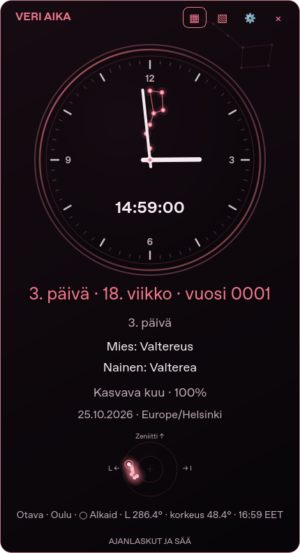
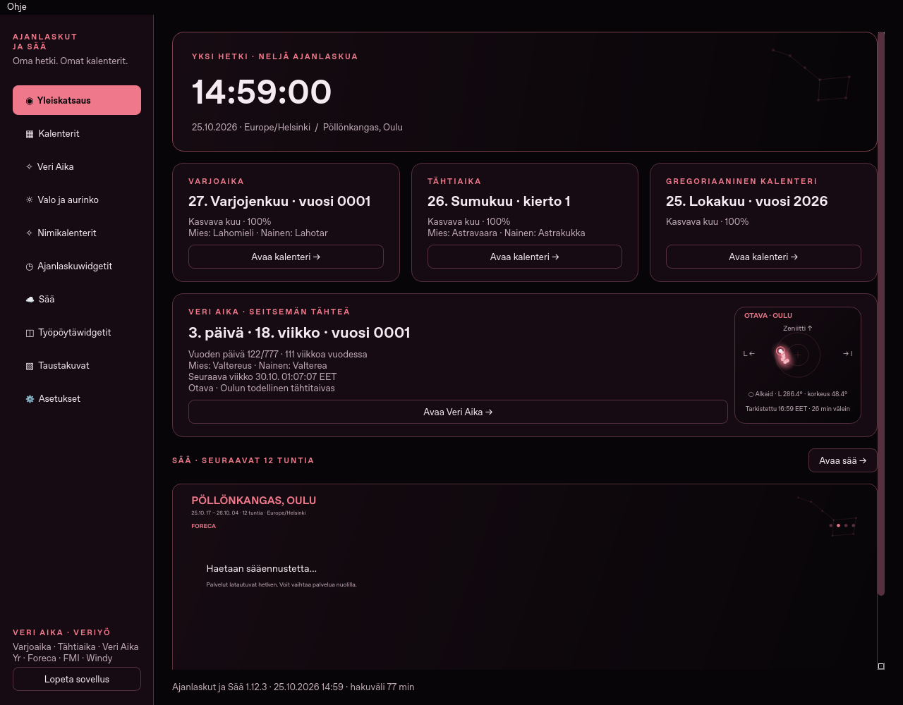

# Ajanlaskut ja Sää 1.12.3 · Otavan suunta

**[Lataa Ubuntu-deb](https://github.com/Jakke77/Ajanlaskut-ja-Saa/raw/refs/heads/packages/v1.12.3/ajanlaskut-ja-saa_1.12.3_all.deb)**
· [Windows](https://github.com/Jakke77/Ajanlaskut-ja-Saa/releases/tag/windows-v1.12.3)
· [Lähdekoodi](Ajanlaskut-ja-Saa-1.12.3-lahdekoodi.zip) · [SHA256SUMS](SHA256SUMS).

Otavan erilliset taivaskuvat etusivulla, Veri Ajan sivulla ja kellon pienessä
kuvassa käyttävät samaa Ouluun laskettua asentoa. Se tarkistetaan heti
käynnistyksessä ja **26 minuutin välein**, myös tarvittaessa lepotilan jälkeen.

Ympyröity tähti on **Alkaid**, Otavan hännän viimeinen tähti. Sen suunta ja
korkeus näkyvät tähtikuvan yhteydessä. Suuntakulma mitataan pohjoisesta:
0° pohjoinen, 90° itä, 180° etelä ja 270° länsi. Ylös on zeniitin suunta,
oikealle itä, vasemmalle länsi ja keskellä pohjoinen taivaannapa.
Tarkistusaika kertoo, miltä hetkeltä asento on; seuraava tarkistus näkyy
osoittamalla kuvaa. Tähtikartan Oulu on kiinteä sääpaikasta riippumatta.

**Kellotaulun Otava säilyy symbolisena sekuntiviisarina.** Todellinen
26 minuutin välein tarkistettava asento näkyy erillisessä tähtikuvassa.
Uusia asetusvalintoja ei tarvita. Kalenterit, nimet ja merkinnät säilyvät.

Ubuntu: asenna latauskansiossa:

```bash
sudo apt install ./ajanlaskut-ja-saa_1.12.3_all.deb
```

Lopeta vanha sovellus **Lopeta sovellus** -painikkeella ja avaa uusi.
Version pitää olla **1.12.3**. `codex-ajanlasku` on erillinen käyttäjäasennus;
[sen päivitysohje](https://github.com/Jakke77/Ajanlaskut-ja-Saa/blob/codex/otava-26min/UPDATES.md).

Windows: pura ZIP uuteen kansioon, lopeta vanha sovellus ja avaa uuden kansion
Ajanlaskut-ja-Saa.exe. Päivitä pikakuvakkeet Luo-pikakuvakkeet.cmd-tiedostolla.
Jos automaattikäynnistys on käytössä, ota uudessa versiossa kirjautumiskäynnistys
pois, tallenna ja ota takaisin käyttöön. Näin polku päivittyy nykyiseen kansioon.

425 Ubuntu-testiä ja viimeisen tarkennuksen kuusi sampler-testiä läpäisi.
Testit kattavat tarkan 26 minuutin rajan, talviaikaan siirtymisen toistuvan
tunnin, lepotilan, kellon korjauksen ja näkymien yhteisen näytteen. Aiemmat
Astropy/ERFA-tähtipaikkavertailut ja sekuntiviisarin testit säilyvät.
Debin ja lähde-ZIPin 2 333 tiedostoa vastaavat lähdettä.

[Testiloki](QA-unit.log) · [Tarkistusvälin testit](QA-sampling.log) · [Pakettitarkistus](QA-package.json).



