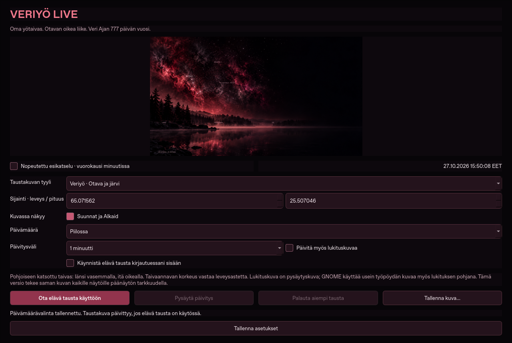
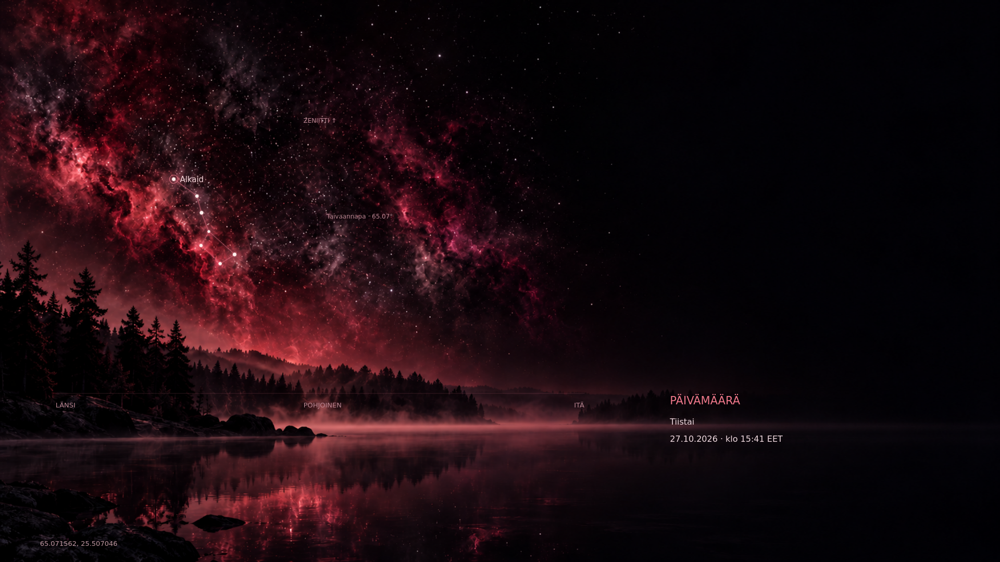

# Veriyö Live 0.1.1 · Ubuntu ja Windows

Taustakuvan päivämäärän voi nyt valita suoraan sovelluksesta:

- **Piilossa** — taustakuvassa ei näy päivämäärää tai kellonaikaa.
- **Veri Aika** — 777 päivän ajanlasku.
- **Tavallinen päivämäärä** — päivämäärä ja kellonaika Suomen ajassa.
- **Molemmat** — kumpikin samassa kuvassa.

Valinta tallentuu heti ja päivittää myös jo käynnissä olevan taustakuvan.
Vanha päivämäärävalinta säilyy päivityksessä.

## Lataa

- **[Ubuntu: veriyo-live_0.1.1_all.deb](veriyo-live_0.1.1_all.deb?raw=true)**
- **[Windows ZIP ja julkaisutiedot](https://github.com/Jakke77/Ajanlaskut-ja-Saa/releases/tag/veriyo-live-v0.1.1)**
- [Lähdekoodi ZIP](Veriyo-Live-0.1.1-lahdekoodi.zip?raw=true)
- [Käyttöohje](KAYTTOOHJE.md)
- [Tarkisteet](SHA256SUMS)

Ubuntu:

```bash
sudo apt install ./veriyo-live_0.1.1_all.deb
```

Sulje vanha Veriyö Live kokonaan. Windowsissa käytä ilmoitusalueen **Lopeta**-valintaa,
pura uusi ZIP pysyvään kansioon ja käynnistä uusi **Veriyo-Live.exe**. Jos
kirjautumiskäynnistys on valittuna, paina **Tallenna asetukset** uudessa versiossa.
Ubuntu-päivityksen jälkeen avaa sovellus uudelleen.






Lähdecommit: `d1e82ec834ebd8fab04ac16c8f5f0c21ab77c72d`. Debianin ja lähde-ZIP:n kaikki 55 tiedostoa verrattu
lähteeseen; molempien sisältä ajetut 38 testiä ja PNG-vienti läpäisivät tarkistukset.
[Tarkistusraportti](QA-package.json).

Otavan liike ja lukitusnäytön tuki toimivat samoilla ehdoilla kuin aiemmin.
Lukituskuva on pysäytyskuva; käyttöjärjestelmä ei takaa jo näkyvän lukitusnäytön virkistymistä.
