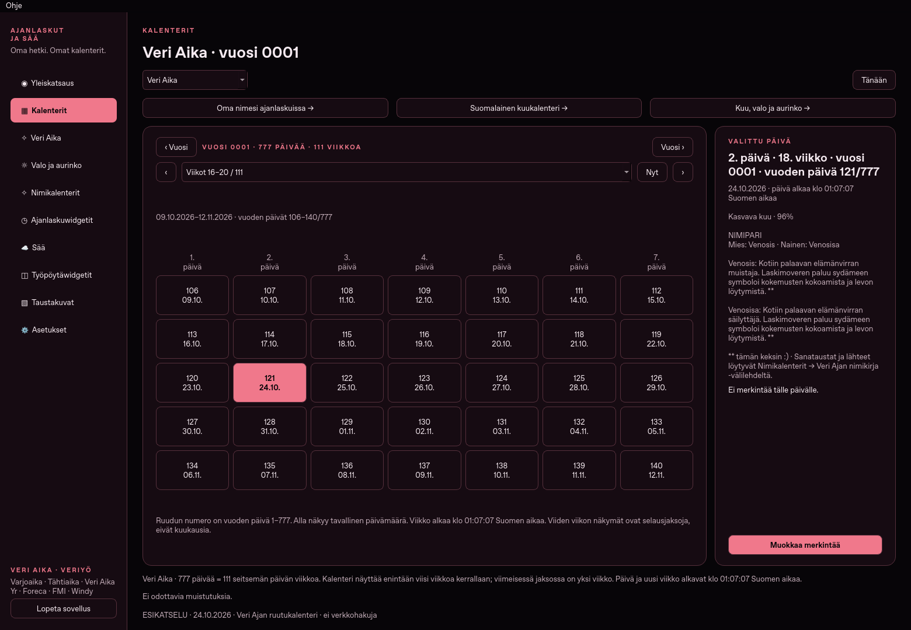
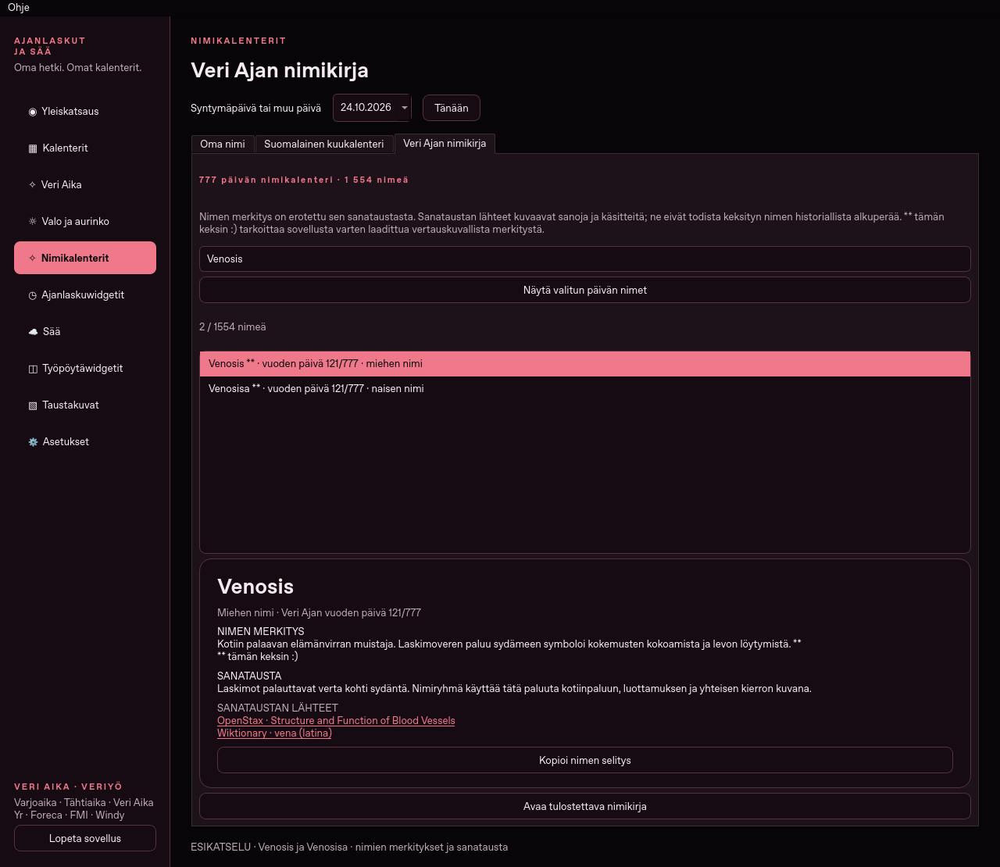
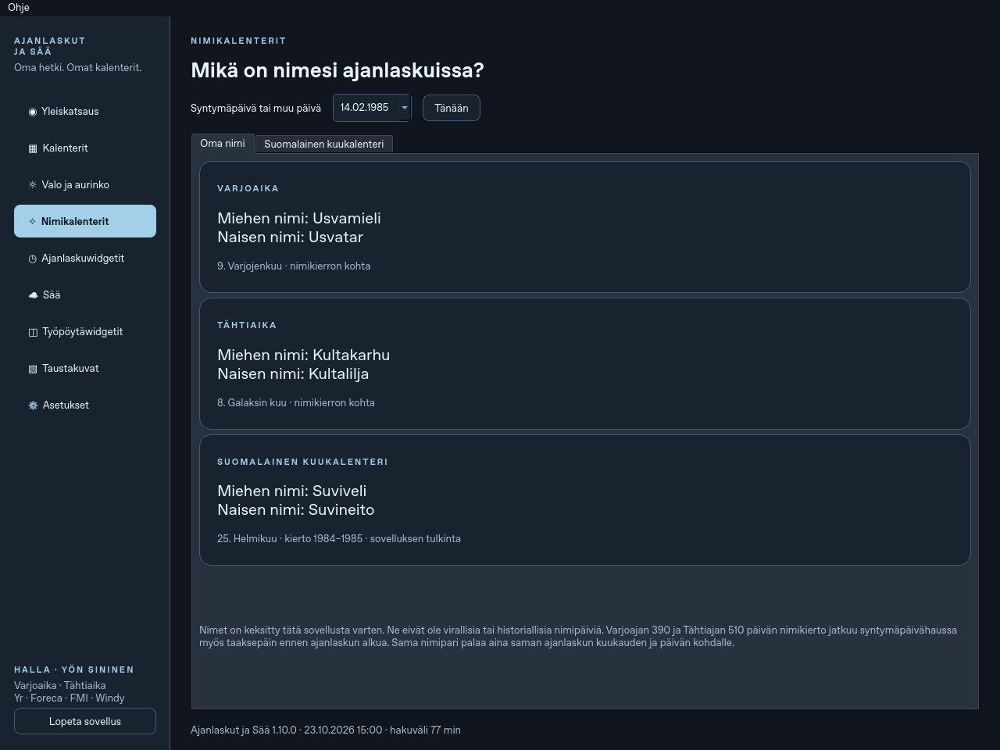
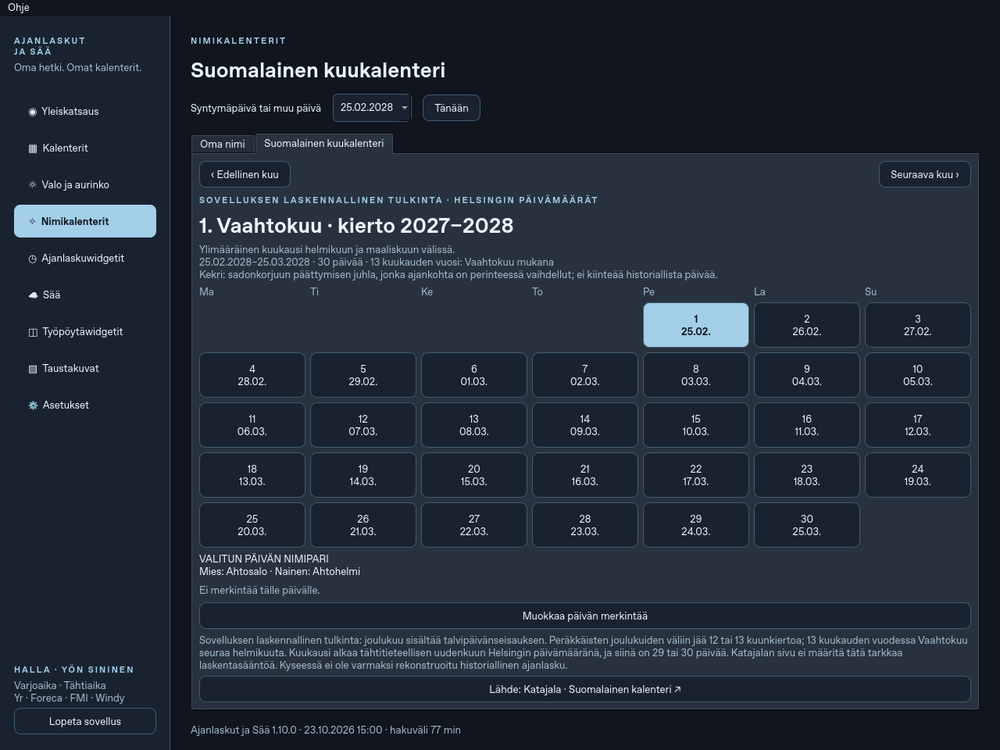
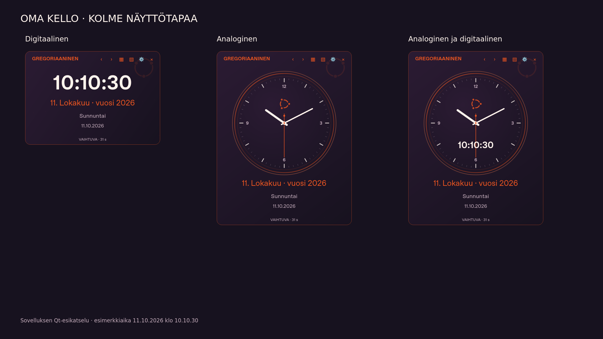
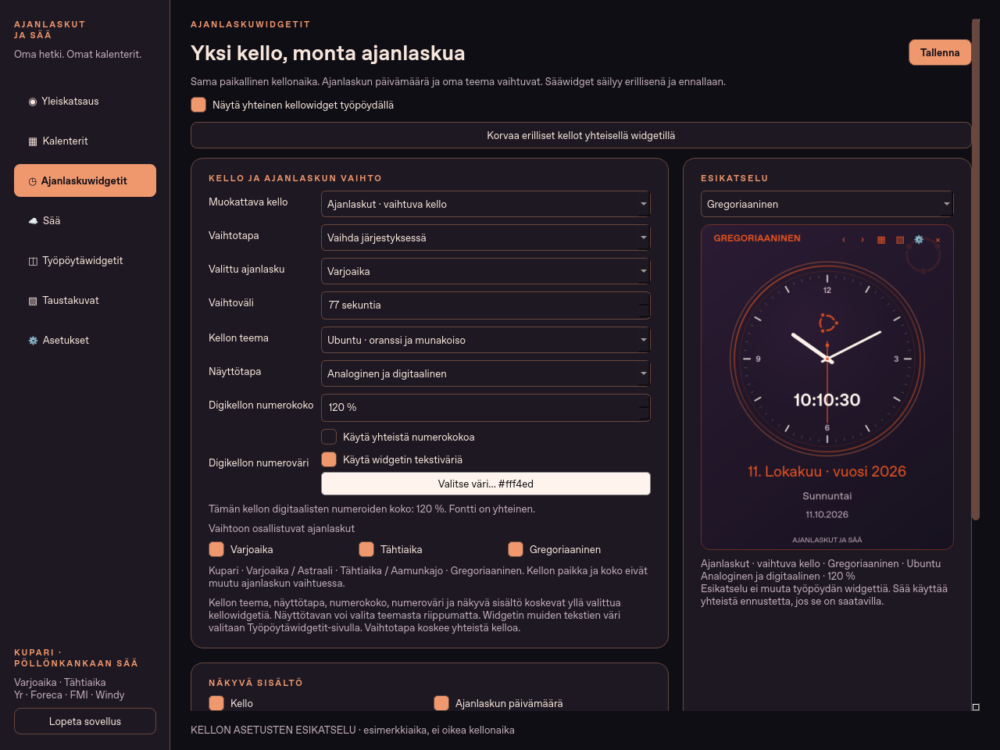
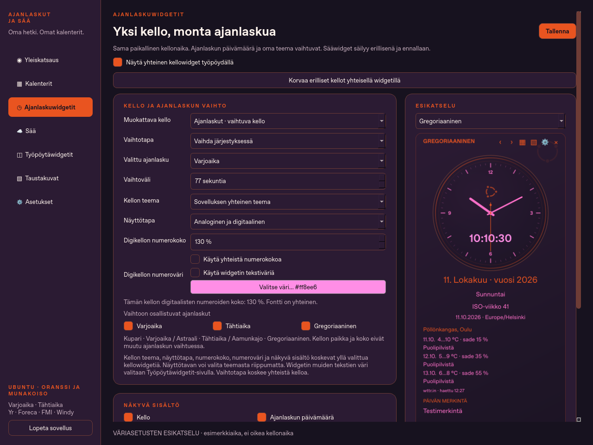
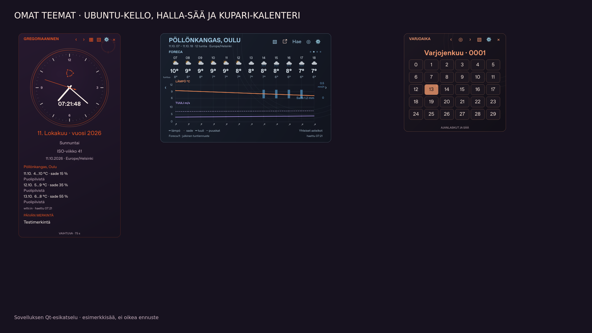
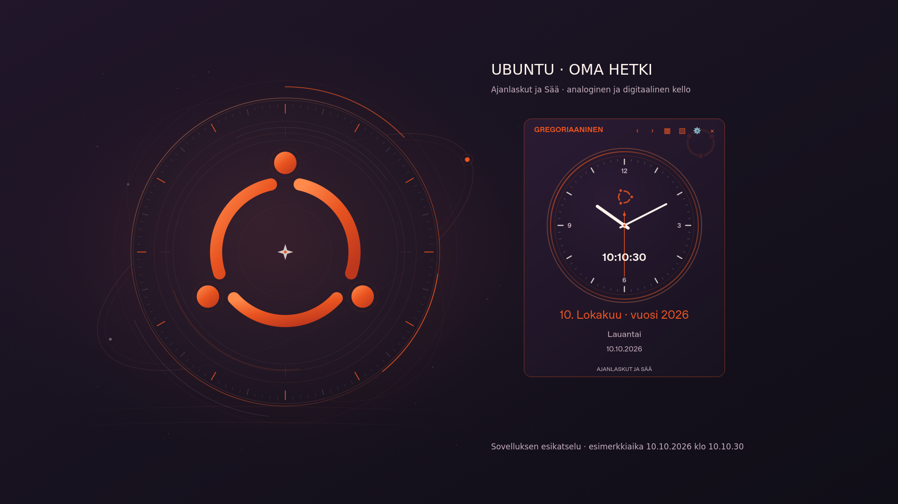

# Ajanlaskut ja Sää

**Uusin Ubuntu-paketti: [1.12.3 · Otavan suunta ja 26 minuutin tarkistus](https://github.com/Jakke77/Ajanlaskut-ja-Saa/tree/packages/v1.12.3).**
Windows: [1.12.3:n julkaisusivu](https://github.com/Jakke77/Ajanlaskut-ja-Saa/releases/tag/windows-v1.12.3).
Katso [asennus ja nykyisen käyttäjäasennuksen päivitys](UPDATES.md#valmiin-deb-paketin-asentaminen).
Kuvaketoiminnot löytyvät **Asetukset → vieritä alas → Sovelluskuvakkeet** tai
**Taustakuvat → vieritä alas → Sovelluskuvakkeet**. Ne puuttuvat 1.6-versioista.
Sulje vanha ohjelma valikon **Lopeta sovellus** -komennolla ennen uuden käynnistystä.
Ikkunan otsikko ja alareuna näyttävät käynnissä olevan version.

Oma Ubuntu-työpöytäsovellus: Varjoaika, Tähtiaika, Veri Aika, tavallinen kalenteri ja sää
yhteisessä käyttöliittymässä. Tämä ei käynnistä neljää vanhaa sovellusta taustalle.
Kaikki näkymät ja widgetit toimivat samassa sovelluksessa ja käyttävät yhteisiä
asetuksia.

## Otavan suunta Oulusta · 1.12.3

Erilliset Otavan taivaskuvat etusivulla, Veri Ajan sivulla ja kellon
pienessä tähtikuvassa käyttävät yhtä yhteistä asentoa. Tarkistus tehdään
heti käynnistyksessä ja sen jälkeen **26 minuutin välein**. Lepotilan tai
kellon korjauksen jälkeen asento lasketaan tarvittaessa uudelleen.

**Alkaid**, Otavan hännän viimeinen tähti, on ympyröity. Kuvan vieressä
näkyvät sen ilmansuunta, suunta asteina (0° pohjoinen, 90° itä, 180° etelä,
270° länsi) ja korkeus horisontista. Ylös on zeniitin suunta, oikealle itä ja
vasemmalle länsi. Kuvan keskus on pohjoinen taivaannapa. Tarkistettu-aika
kertoo, miltä hetkeltä asento on; seuraava tarkistus näkyy osoittamalla kuvaa.
Koordinaatit ovat kiinteästi Oulussa riippumatta sääpaikasta tai kellon aikavyöhykkeestä.
Kuva on geometrinen tähtikartta, ei ennuste tähtien näkymisestä pilvien läpi.

Kellotaulun Otava säilyy käyttäjän toiveen mukaan **symbolisena sekuntiviisarina**.
Se näyttää ajan kulkua; erillinen taivaskuva näyttää todellisen taivasasennon.

## Veri Ajan ruutukalenteri ja nimien merkitykset · versio 1.12.2

**Kalenterit → Veri Aika** näyttää nyt varsinaisen ruutukalenterin samalla
sivulla muiden kalenterien kanssa. Seitsemän päivän viikot ovat allekkain:
näkymässä on viisi viikkoa eli 35 päivää kerrallaan. Vuodessa on edelleen
777 päivää ja 111 viikkoa. Vuoden viimeisessä näkymässä on yksi viikko.
Näkymät ovat selausjaksoja, eivät uusia kuukausia. Valitse ruudusta päivä:
sen nimet, selitykset ja yhteiset kalenterimerkinnät löytyvät päivän tiedoista.
Myös Otavan yhteydessä oleva Veri Ajan sivu käyttää samaa ruudukkoa.

**Nimikalenterit → Veri Ajan nimikirja** sisältää kaikkien **1 554 nimen**
selitykset. Hae nimeä tai merkitystä ja kopioi selitys talteen. Syntymäpäivä
valitaan edelleen **Oma nimi** -välilehdellä. Aiemmat nimiparit ja niiden
paikat 777 päivän kierrossa säilyvät täsmälleen samoina.

Sanatausta ja lähteet esitetään erikseen nimelle kirjoitetusta symbolisesta
merkityksestä. Lähteet kertovat esimerkiksi veren, solujen tai verenkierron
sanastosta; samankaltainen ääni ei yksin todista nimen historiallista alkuperää.
Oma tulkinta merkitään kirjaimellisella merkillä `**`. Selite on käyttäjän
pyytämä **`** tämän keksin :)`**. Näin itse kirjoitetut vertauskuvat voi erottaa
lähteissä esitetyistä tiedoista myös myöhemmin.

Nimikirja toimii kokonaan ilman verkkoa. **Avaa tulostettava nimikirja**
avaa mukana olevan itsenäisen HTML-tiedoston selaimeen. Sen voi säilyttää,
tulostaa tai tallentaa selaimella PDF:ksi. Verkkoa tarvitaan vain, jos avaat
jonkin lähdelinkin. [Markdown-nimikirja](assets/namebooks/veri-ajan-nimikirja.md)
on luettavissa myös tässä repossa; [HTML-versio](assets/namebooks/veri-ajan-nimikirja.html)
säilyy luettavana ilman sovellusta.




## Veri Aika: 777 päivän vuodet ja omat nimet · versio 1.12.1

**Veri Aika** löytyy suoraan sivuvalikosta sekä **Kalenterit → Veri Aika**.
Alkuhetki on **26.6.2026 klo 01:07:07 Suomen aikaa**. Päivä vaihtuu klo
01:07:07, ja joka seitsemäs päivä alkaa uusi viikko. **Vuodessa on 777 päivää
eli 111 täyttä viikkoa.** Vuoden päivät 1–777 ja viikot 1–111 alkavat uudelleen
ykkösestä vuoden vaihtuessa. Vuosi 0002 alkaa 11.8.2028 klo 01:07:07, ei
gregoriaanisen vuoden tai alkupäivän vuosipäivän kohdalla. Kuukausia ei ole.
Suomen kesä- ja talviaika huomioidaan. Ennen alkua valittu päivä merkitään
selvästi ajanlaskua edeltäväksi. Kalenterista voi avata yhteisen päivän merkinnät.

**777 omaa nimiparia:** jokaisella vuoden päivällä on pysyvä miehen ja naisen
nimi. Nimet ammentavat verestä, verenkierrosta, soluista ja elämän sanastosta:
esimerkiksi **Rubino / Rubina**, **Hemero / Hemera**, **Sereno / Serena** ja
**Fibriano / Fibria**. Ne ovat tätä sovellusta varten keksittyjä nimiä.
Sama pari palaa saman vuodenpäivän kohdalle seuraavana 777 päivän vuonna.

Nimet näkyvät **Veri Aika** -sivulla, päivän vihjeessä ja etusivulla.
**Nimikalenterit → Oma nimi** löytää parin myös omasta syntymäpäivästä ja
jatkaa nimikiertoa ennen ajanlaskun alkua. Widgetin nimet saa näkyviin tai pois
**Ajanlaskuwidgetit → Näkyvä sisältö → Päivän nimipari** -valinnasta;
yhteisessä ja Veri Ajan kellossa ne ovat oletuksena näkyvissä.
Kalenterissa voi selata myös 777 päivää edelliseen tai seuraavaan vuoteen.

Etusivulla, Veri Ajan kalenterissa ja kellon **Otavan todellinen asento · Oulu**
-sisältökentässä näkyy seitsemän tähden kuvio oikeassa asennossaan Oulun
pohjoistaivaalla. Kuvio liikkuu ajan mukana vakaan pohjoisen taivaannavan
ympärillä: ylös on zeniitti, oikealle itä. Tähtien korkeudet ja ilmansuunnat
näkyvät kalenterikuvan vihjeessä. Paikka on tarkoituksella kiinteä Oulu,
vaikka sääpaikka tai kellon aikavyöhyke vaihtuisi. Laskenta toimii offline,
vuosina 1900–2100. Se kuvaa tähtien geometriaa, ei näkyvyyttä päivänvalossa tai pilvien läpi.

**Ajanlaskuwidgetit → Näyttötapa → Otavakello** tai **Otavakello ja digitaalinen**
vaihtaa kellotaulun: tunti- ja minuuttiviisarit näyttävät ajan, Otavan
seitsemän tähden kuvio toimii sekuntiviisarina. Tämä kuvio kiertää symbolisesti
kerran minuutissa; erillinen taivaskuva näyttää todellisen tähtiasennon.
**Asetukset → Näytä sekunnit** piilottaa myös tämän sekuntikuvion.
Valitse samalla **Valittu ajanlasku → Veri Aika**, tai lisää se vaihtoon
osallistuvien ajanlaskujen joukkoon. Tallenna. Vanha tallennettu kiertojoukko säilyy päivityksessä.

**Asetukset → Teema → Veri Aika · Veriyö** tuo lähes mustan viininpunaisen
paletin. Teeman voi valita myös yksittäiselle widgetille. **Taustakuvat**
-sivulla ovat **Veriyö · Otava** ja **Veriyö · Hiillos**. Taustakuvien ja
paneelikoristeen Otava on staattista kuvitusta; se ei väitä näyttävänsä nykyhetken taivasta.
Ubuntu-paketissa on myös yhteensopiva Veriyö-kuvaketeema.
Windows-version samat kalenteri- ja kello-ominaisuudet säilyttävät
Windowsin omat työpöytä- ja saavutettavuusasetukset.


## Kuu, nimikalenterit ja päivän valo · versio 1.10.0

Kellot ja yleiskatsaus näyttävät nyt saman todellisen kuunvaiheen ja valaistun
osuuden. Kalenterista valitun päivän vaihe lasketaan klo 12 kalenterin
aikavyöhykkeellä. Varjoajan 390 ja Tähtiajan 510 päivän päiväykset säilyvät;
niiden omia symbolisia vaiheita ei enää esitetä oikean Kuun tietona.

**Nimikalenterit → Oma nimi:** valitse syntymäpäivä tai muu päivä. Varjoajalla
on 390 ja Tähtiajalla 510 pysyvää nimiparia: miehen ja naisen nimi jokaiselle
päivälle. Varjoajan nimet ovat tummasävyisiä, Tähtiajan nimet valon ja avaruuden
henkisiä. Haku toimii myös ennen ajanlaskujen alkupäiviä jatkamalla nimikiertoa
taaksepäin. Nimet ovat tätä sovellusta varten keksittyjä, eivät virallisia
nimipäiviä. Nimipari näkyy myös kalenterin päivän tiedoissa ja kellon vihjeessä.

**Nimikalenterit → Suomalainen kuukalenteri** perustuu
[Katajalan perinnekalenterin kuvaukseen](https://www.katajala.net/viikinkiaika/ajanlasku/suomalainen_kalenteri.html).
Toteutus on nimenomaisesti **sovelluksen laskennallinen tulkinta**: joulukuu
sisältää talvipäivänseisauksen. Peräkkäisten joulukuiden väliin jää 12 tai 13
kuukautta; 13 kuukauden vuodessa **Vaahtokuu** sijoittuu helmikuun jälkeen.
Kuukausi alkaa uudenkuun Helsingin päivämääränä ja kestää 29 tai 30 päivää.
Lähdesivu ei määritä tätä tarkkaa sääntöä. Mukana on 390 itse keksittyä
suomalaishenkistä nimiparia; ne eivät ole historiallisia nimipäiviä. Kekri
kuvataan sadonkorjuun juhlana ilman keksittyä kiinteää historiallista päivää.
Päivän merkinnät ja muistutukset käyttävät samaa tavallista päivämäärää kuin
muissa kalentereissa.

**Valo ja aurinko:** Auringon ja Kuun nousu- ja laskuajat, päivän pituus,
kolme hämärärajaa, kuun kuva, seuraavat neljä päävaihetta ja kuukauden valoajat.
Valitse päivä taulukosta tai hae paikka. Paikka on yhteinen sääsivun kanssa;
ajat esitetään paikan aikavyöhykkeellä kesäaika huomioiden. Kaamos, yötön yö ja
päivät, joina Kuulla on vain nousu tai lasku, näytetään erikseen.

Tähtitiedot lasketaan ilman verkkohakua mukana olevalla PyMeeus-kirjastolla
vuosille 1900–2100. Nousuajat ovat arvioita tasaiselle horisontille ja
tavanomaiselle ilmakehälle; maasto ja sää voivat muuttaa havaittuja aikoja.
Kalenterit-sivulla on suorat linkit kaikkiin uusiin näkymiin.





## Sadekartat widgetin kokoisiksi · versio 1.9.1

**Sää → Foreca tai Ilmatieteen laitos → Sadekartta** avaa kartan koko
sisältöalueelle sekä pääikkunassa että sääwidgetissä. Versiossa 1.9.0 mukana
näkyivät verkkosivun otsikot, sivuvalikot ja mainosalueet; uusi versio käyttää
palvelun omaa kartan suurennustoimintoa sovelluksen sisällä. Pääikkuna ja
widgetti säilyvät tavallisen kokoisina.

Kartan säätimet, aikajana, selitteet ja lähdemerkinnät säilyvät. Foreca käyttää
valitun paikan koordinaatteja omassa uudessa tutkanäkymässään. Ilmatieteen
laitoksen kartta on Suomen yhteinen sadekartta, jonka aluetta voi siirtää itse.
12/24 tunnin valinta näkyy vain sovelluksen omissa ennustegraafeissa.

Palvelun mahdolliset evästevalinnat tehdään sen omassa ikkunassa. Palvelu voi
pyytää valintaa uudelleen sovelluksen seuraavalla käynnistyskerralla. Jos kartan
avaaminen ei onnistu, käytä uudelleenyritystä tai **Avaa selaimessa** -painiketta.

## Sadekartat ja Windyn tuntiennuste · versio 1.9.0

Valitse **Sää → Palvelu** ja sitten **Näkymä**. Foreca ja Ilmatieteen laitos
tarjoavat ennustegraafin lisäksi oman **Sadekartta**-sivunsa. Windylle voi valita
**Sääkartan** tai kartattoman **Tuntiennusteen**. Sääwidgetin oikean painikkeen
valikossa on sama näkymävalinta, ja sovellus muistaa valinnan palvelukohtaisesti.
Yr säilyttää sovelluksen oman 12/24 tunnin graafin.

Forecan kartta käyttää versiosta 1.9.1 lähtien valittuja koordinaatteja omassa
tutkanäkymässään. Ilmatieteen laitoksen sadekartta on Suomen
yhteinen näkymä. Windyn tuntiennuste käyttää valittuja koordinaatteja ja näyttää
Windyn oman ennustetaulukon sääsymboleineen. Se ei käytä toisen palvelun tietoja
Windyn nimellä. Windyn omaan piirrettyyn ennustekäyrään tarvittaisiin erillinen
lisensoitu API.

Kartat käyttävät palvelujen omia karttanäkymiä. Niiden omat
merkinnät, evästevalinnat ja käyttöehdot säilyvät. Näkymässä on myös avaus
tavalliseen selaimeen ja uudelleenyritys latausvirheen varalta. Verkkonäkymät
tarvitsevat PyQt6 WebEnginen ja verkkoyhteyden; niiden oma aikajana korvaa
sovelluksen 12/24 tunnin valinnan.

Erillinen Android-sääsovellus ja sen kotinäyttöwidgetit ovat
[omassa paketissaan](https://github.com/Jakke77/Ajanlaskut-ja-Saa/tree/packages/android/v0.1.0).

## Tietoa sovelluksesta · versio 1.8.2

**Ohje → Tietoa sovelluksesta** näyttää käynnissä olevan version ja sen
asennuskansion. Sama toiminto löytyy Asetuksista, sääwidgetin oikean painikkeen
valikosta ja ilmoitusalueen valikosta. Tiedot voi kopioida.

Jos Ubuntu 26.10 Dark puuttuu, tarkista tämä versionumero. Teema on mukana
versiosta 1.8.0 lähtien. Järjestelmän `.deb` ja `codex-ajanlasku` ovat kaksi
asennusta: esimerkiksi `/usr/bin/ajanlaskut-ja-saa --version` voi näyttää
1.8.1 ja `codex-ajanlasku run --version` samalla 1.6.0. Lopeta vanha ohjelma
**Lopeta sovellus** -komennolla ja avaa uusi järjestelmäasennus komennolla
`/usr/bin/ajanlaskut-ja-saa --page settings`, tai päivitä käyttäjäasennus
[ohjeen mukaan](UPDATES.md#eri-versiot-järjestelmä--ja-käyttäjäasennuksessa).

## Windy-kartan latauskorjaus · versio 1.8.1

Windy ladataan vasta karttanäkymän tullessa näkyviin. Epäonnistuneen latauksen
voi yrittää uudelleen **Yritä uudelleen** -painikkeella tai sääsivun **Päivitä**
-painikkeella. Päivitä lataa myös pääikkunan kartan uudelleen, vaikka ennusteen
haku olisi kesken. **Avaa Windy selaimessa** avaa saman paikan ja karttarajauksen.
Taustalla tapahtuva ennustepäivitys ei lataa toimivaa karttaa uudelleen.

## Ubuntu 26.10 Dark · versio 1.8.0

Uusi **Ubuntu 26.10 Dark** yhdistää tumman pohjan, munakoison sävyt ja
Ubuntu-oranssin. Se on tämän sovelluksen oma teema, joka käyttää
[Ubuntun virallista väripalettia](https://design.ubuntu.com/brand/colour-palette).
Mukana tulevat yhteensopiva taustakuva ja neljäs kuvaketeema.

1. Valitse **Asetukset → Teema → Ubuntu 26.10 Dark** ja tallenna.
   **Käytä valittua teemaa kaikissa widgeteissä** ottaa sen käyttöön myös
   widgeteissä, joille on aiemmin valittu oma teema.
2. Taustakuva vaihtuu tallennettaessa, jos **Taustakuva teeman vaihtuessa →
   Vaihda teeman mukana** on käytössä. Sen voi vaihtaa erikseen
   **Taustakuvat → Aseta Ubuntu 26.10 Dark-teeman tausta** -painikkeesta.
3. Kuvakkeet ovat vapaaehtoiset: vieritä Asetukset-sivulla
   **Sovelluskuvakkeet**-osioon. Paina **Asenna ja korjaa sovelluskuvakkeet**
   ja sitten **Käytä nykyisen teeman kuvakkeita**. Jos haluat kuvakkeiden
   vaihtuvan jatkossakin yhteisen teeman mukana, valitse **Kuvakkeet teeman
   vaihtuessa → Vaihda teeman mukana** ja tallenna.

Uusi teema löytyy myös yksittäisen widgetin ja kellon teemavalinnoista.
Niiden omat valinnat eivät vaihda työpöydän taustakuvaa tai kuvakkeita.
Päivitys säilyttää nykyisen teeman ja kuvakkeiden vaihtovalinnan.

## Kuvakkeet yhteisen teeman mukaan · versio 1.7.0

**Asetukset** ja **Taustakuvat** tarjoavat samat työpöydän kuvakevalinnat.
Kupari-, Halla-, Ubuntu- ja Ubuntu 26.10 Dark -kuvaketeemat tulevat sovelluksen
mukana; erillistä latausta tai teema-repon valintaa ei tarvita.

1. Paina **Asenna ja korjaa sovelluskuvakkeet**. Se asentaa kaikki kuvaketeemat ja
   korjaa tuettujen sovellusten kuvakkeet sovellusvalikossa ja telakassa myös
   silloin, kun Firefox tai Thunderbird on Snapina tai GIMP apt-pakettina.
2. Paina **Käytä nykyisen teeman kuvakkeita**, kun haluat ottaa sovelluksen
   tallennettua yhteistä teemaa vastaavat kuvakkeet käyttöön heti.
3. Jos haluat kuvakkeiden vaihtuvan jatkossa taustakuvan kanssa, valitse
   **Kuvakkeet teeman vaihtuessa → Vaihda teeman mukana** ja tallenna.
   Taustakuvan oma teemanvaihdon valinta on erillinen. Kumpikin valinta seuraa
   Asetukset-sivun yhteistä teemaa; yksittäisen widgetin teema ei muuta työpöytää.

Oletuksena **Säilytä nykyiset kuvakkeet** pitää aiemmat kuvakkeet käytössä.
Valinnan tallentaminen yksin ei vielä vaihda kuvakkeita, ja sivujen keskeneräiset
valinnat säilyvät erillisinä luonnoksina. Asennus- ja palautuspainikkeet eivät
tallenna näitä luonnoksia. Sovelluksen käynnistäminen tai kellojen kierto ei
vaihda työpöydän taustaa tai kuvakkeita.

**Väritä myös muut sovellukset yleiskuvakkeilla** antaa muille sovelluksille
käyttötarkoitukseen sopivan kuvakkeen niiden oman tunnuksen sijaan. Valinta
koskee seuraavaa **Asenna ja korjaa** -painallusta. Ohjelmien sisäiset
työkalupainikkeet eivät kuulu työpöydän kuvaketeemaan.

**Palauta edellinen kuvaketeema** palauttaa aiemman työpöydän kuvaketeeman ja
poistaa kuvakkeiden automaattisen vaihdon käytöstä. **Palauta sovelluskuvakkeet**
peruu erikseen sovellusvalikon kuvakekorjaukset.

Versiossa 1.8.0 **Käytä järjestelmän oletuskuvakkeita** ottaa käyttöön tämän
järjestelmän oman oletuskuvaketeeman, palauttaa sovelluksen tekemät
sovelluskuvakekorjaukset ja poistaa kuvakkeiden automaattisen teemanvaihdon
käytöstä. Painike toimii myös ilman aiemman teeman varmuuskopiota.
**Palauta edellinen kuvaketeema** säilyy erillisenä valintana, jos haluat
palata esimerkiksi itse valitsemaasi kuvaketeemaan.

Muutokset tehdään vain
nykyiselle käyttäjälle ilman pääkäyttäjän oikeuksia. Kuvakkeiden vaihto tarvitsee
GNOME-työpöydän; teemat voi asentaa myös muualla.

## Taustakuvatoimintojen näkyvä palaute · versio 1.6.2

Tallennuksen, taustakuvan asettamisen ja virheiden viestit näkyvät nyt
Taustakuvat-sivun toimintopainikkeiden vieressä. **Aseta Ubuntu-teeman tausta**
(tai Kupari/Halla) kertoo, minkä teeman kuva asetetaan. Galleriassa valitun kuvan
asettaa **Työpöydän taustaksi** -painike.

[Lataa uusin 1.12.1-deb-paketti ja tarkiste](https://github.com/Jakke77/Ajanlaskut-ja-Saa/tree/packages/v1.12.1).
Se sisältää myös alla kuvatut kellon ja tekstivärien säädöt.

## Kellon näyttötapa, numerokoko ja tekstivärit · versio 1.6.1

**Ajanlaskuwidgetit → Muokattava kello** tarjoaa jokaiselle kellolle omat
näyttötavan ja diginumeroiden säädöt.

Samalla sivulla **Näyttötapa** valitsee **Digitaalisen**, **Analogisen** tai
**Analogisen ja digitaalisen** kellon teemasta riippumatta. **Teeman oletus**
säilyttää aiemman ulkoasun: Ubuntu näyttää molemmat, muut teemat digikellon.
Jokaisella kellolla voi olla oma näyttötapa.

**Digikellon numerokoko** säätää valitun kellon digitaalisia numeroita
80–140 %. Poista ensin **Käytä yhteistä numerokokoa** -valinta. Valinnat näkyvät
esikatselussa heti; **Tallenna kelloasetukset** ottaa ne käyttöön työpöydällä.
Yhteistä kokoa ja fontin perhettä voi edelleen säätää Asetukset-sivulla.
Analogisessa näyttötavassa diginumeroiden säätö on pois käytöstä.
Kellon **⚙** avaa suoraan kyseisen kellon asetukset.





**Työpöytäwidgetit → Tekstiväri** antaa jokaiselle kahdeksalle widgetille
oman värin. Valitse väri painikkeesta ja paina **Tallenna widgettien ulkoasu**.
**Käytä teeman tekstiväriä** palauttaa teeman mukaisen värin.
Otsikot, korostukset ja sääkäyrät säilyttävät teeman ja sääsuureiden värit.

Digiajan numerot voi värittää erikseen **Ajanlaskuwidgetit → Digikellon numeroväri**.
Ilman omaa numeroväriä ne seuraavat widgetin tekstiväriä. Valinta näkyy
esikatselussa heti ja tulee työpöydälle tallennettaessa kelloasetukset.
Omat värit säilyvät teeman vaihdossa.

**Taustakuvat**-sivun alasvetovalintojen luonnokset säilyvät sivua päivittäessä.
Lukitusnäytön ja molempien kohteiden valinnat sekä vaihtuvat kuvat kertovat nyt
selvästi **Dia Wall 77** -lisäosan vaatimuksesta. Ilman lisäosaa GNOMEn
lukitusnäyttö seuraa työpöydän taustakuvaa: käytä **Työpöydän taustaksi** -painiketta.



Valmis Debian-paketti ja asennusohje julkaistaan GitHubin
[packages/v1.12.1-haarassa](https://github.com/Jakke77/Ajanlaskut-ja-Saa/tree/packages/v1.12.1).
Paketti ei tarvitse lähdekoodin rakentamista. [Deb-asennus ja käyttäjäasennuksen päivitys](UPDATES.md#valmiin-deb-paketin-asentaminen).

## Oma teema jokaiselle widgetille · versio 1.6.0



**Työpöytäwidgetit → Teema** tarjoaa jokaiselle kahdeksalle widgetille oman
**Kupari**, **Halla**, **Ubuntu** tai **Ubuntu 26.10 Dark** -valinnan.
**Sovelluksen yhteinen teema** seuraa Asetukset-sivun teemaa. Valinnat otetaan käyttöön painikkeesta
**Tallenna widgettien ulkoasu**; pelkkä valikon vaihtaminen on vielä luonnos.
Esimerkiksi Ubuntu-kello, Halla-säägraafi ja Kupari-kuukausiwidget voivat näkyä
samaan aikaan. Widgetin oikean painikkeen **Widgetin teema…** avaa saman sivun.

**Ajanlaskuwidgetit → Muokattava kello → Kellon teema** muuttaa kyseisen kellon
teemaa. Kellot tarjoavat lisäksi **Ajanlaskun oma teema** -valinnan. Valittu
kello näkyy esikatselussa, ja sen sisältö tallentuu omana profiilinaan.

**Asetukset → Teema → Ubuntu** antaa yhteisen Ubuntu-ilmeen myös sääwidgetille.
Valitsemalla **Käytä valittua teemaa kaikissa widgeteissä** ja tallentamalla
voi palauttaa kaikki widgetit seuraamaan tätä teemaa yhdellä kertaa.
Omat teemavalinnat säilyvät tavallisessa yhteisen teeman vaihdossa.
Yksittäisen widgetin teemavalinta ei vaihda työpöydän taustakuvaa.

Vanhojen asennusten kelloteemat säilyvät päivityksessä. Uudessa asennuksessa
widgetit seuraavat yhteistä teemaa, kunnes niille valitaan oma teema.
Sääteeman vaihto päivittää paletin ja koristeet säilyttäen sääpalvelun,
ennusteen, hakuvälin ja kartan. Ubuntu-kellon vähimmäiskorkeus on edelleen
suurempi kuin digitaalisen kellon.

**Päivityksen jälkeen valitse vanhasta ohjelmasta Lopeta sovellus ja avaa se
uudelleen**, jotta uusi käyttöliittymä tulee näkyviin. [Päivitysohje](UPDATES.md).

## Ubuntu-teema ja analoginen kello · versio 1.5.0



**Ajanlaskuwidgetit → Kellon teema → Ubuntu · analoginen kello** ottaa käyttöön
oranssin kellotaulun, analogiset viisarit ja digitaalisen ajan. Valinta näkyy ensin
esikatselussa; **Tallenna kelloasetukset** ottaa sen käyttöön työpöydällä.
Sama paikallinen aika ja valittu ajanlasku säilyvät. Sekuntivalinta ohjaa sekä
digitaalisen ajan sekunteja että sekuntiviisaria; **Kellon numeroiden koko**
vaikuttaa digitaaliseen aikaan ja kellotaulun numerointiin.

**Asetukset → Teema → Ubuntu · oranssi ja munakoiso** antaa koko sovellukselle
saman väripaletin. Kellon **Sovelluksen yhteinen teema** seuraa tätä valintaa;
Ubuntu-kellon voi myös valita erikseen Kuparin tai Hallan rinnalle.
Analoginen kellotaulu tarvitsee enemmän korkeutta kuin digitaalinen kello:
lyhyt widget voi kasvaa vähimmäiskokoon ja siirtyä näytön sisään. Ajanlaskun
vaihtuminen ei muuta kellon kokoa. Sisältövalinnat, fontti, vetäminen ja
koonmuutos toimivat myös tässä teemassa.

Mukana on **Ubuntu · oranssi tähtikello** -taustakuva (1920 × 1080),
alkuperäinen paikallisesti piirretty SVG-teos. Teeman mukana vaihtuva tausta
noudattaa aiempaa työpöytä-/lukituskuvan valintaa. Kellon oma teemavalinta
ei vaihda taustakuvaa tai sääwidgetin värejä. Nollan prosentin tausta poistaa
kellon pohjan, kehykset ja koristeet; viisarit, numerot ja tekstit jäävät näkyviin.

Itsenäinen Ubuntu-henkinen faniteema. Ubuntu-nimi ja Circle of Friends
-tavaramerkki kuuluvat Canonicalille. Vanhaan ohjelmaversioon palaaminen:
valitse ensin Kupari/Halla ja aiempi kelloteema, kuten [päivitysohjeessa](UPDATES.md).

## Sovelluksen näkymät

- **Yleiskatsaus:** sama hetki kolmessa ajanlaskussa, tuntiennuste ja kolmen päivän sää.
- **Kalenterit:** Varjoajan 13 kuukautta, Tähtiajan 17 kuukautta ja gregoriaaninen kalenteri.
  Kuukausi- ja vuosivalinta, päivän merkinnät, muistutukset ja valinnaiset rinnakkaispäiväykset.
- **Ajanlaskuwidgetit:** yhteinen vaihtuva kello, omat ajanlaskuteemat,
  sisältövalinnat ja tallentamaton esikatselu.
- **Sää:** Yr/MET Norway, Foreca ja Ilmatieteen laitos 12/24 tunnin graafina;
  Forecan ja Ilmatieteen laitoksen sadekartat sekä Windyn kartta ja tuntiennuste.
  Paikkahaku ja erikseen luvan pyytävä sijaintihaku.
- **Työpöytäwidgetit:** kahdeksan erikseen valittavaa näkymää ja omat teemavalinnat.
- **Taustakuvat:** neljän teeman galleria, oma teema-repo ja omat kuvat; eri taustat
  työpöydälle ja lukitusnäytölle sekä 1–77 minuutin diaesitys.
- **Asetukset:** yhteinen teema, vapaaehtoiset työpöydän kuvakkeet, fontti, koko,
  läpinäkyvyys, aikavyöhyke, sääpaikka, hakuväli, paikkojen lukitus ja kirjautumiskäynnistys.

Yhteiset fonttisäädöt ovat **Asetukset → Ulkoasu ja työpöytä**:
**Widgettien tekstikoko** (80–160 %, oletus 130 %) ja **Yhteinen kellon numerokoko**
(80–140 %, oletus 100 %). Fontin perhe säilyy omana valintanaan. Kokoasetukset
ovat erillisiä koko widgetin koosta, joten ikkunoiden paikat ja mitat eivät muutu.
Säätö koskee uuden sovelluksen kaikkia widgettejä; erillinen vanha sääsovellus
ei käytä näitä asetuksia. Pitkä päiväys tai paikan nimi lyhennetään tarvittaessa,
ja kellon numerot sovitetaan omaan tilaansa. Varjoaika-kellon päiväennusteissa
lämpö/sade ja sääkuvaus näytetään kahdella rivillä.
Kellon oma diginumeroiden koko ohittaa yhteisen koon vain kyseisessä kellossa.

Uudessa asennuksessa näkyvät **yhteinen ajanlaskukello** kolmen päivän säätiedoilla
ja **Pöllönkankaan tuntisää**. Erikseen voi ottaa käyttöön Varjoajan, Tähtiajan
ja gregoriaanisen kellon, Varjosään sekä kuukausiwidgetit. Päivitys säilyttää vanhat
widgetvalinnat, kunnes erilliset kellot korvataan yhteisellä kellolla.

Oletusteema **Kupari** pohjautuu Pöllönkankaan sääwidgetin tummaan, kupariseen
ja läpikuultavaan ilmeeseen. Muut teemat ovat sininen **Halla**, oranssi **Ubuntu**
ja tumma **Ubuntu 26.10 Dark**. Teeman ja fontin
muutos koskee sovellusta ja sääwidgettejä. Kelloilla voi olla omat ajanlaskuteemat
tai sama yhteinen teema. Koko ja taustan
peittävyys koskevat widgettejä. Sääpalvelujen semanttiset käyrävärit säilyvät.

Sään oletushakuväli on **77 minuuttia**. Kellot päivittyvät sekunnin välein ja
säägraafi siirtää näkyvää tuntijaksoa minuutin välein. Säälähteiden välimuisti ja
käyttörajoitukset voivat lykätä uutta verkkohakua. Windyn kartta käyttää omaa
ennusteaikajanaansa. Tavallinen päivittäinen sää on wttr.in-palvelusta.

## Halla-yön tausta ja teemanvaihto · versio 1.4.0

Mukana on **Halla-yön tähtikello**, jäinen hopeansininen Ubuntu-tausta
(1672 × 941 pikseliä). Se ja Kuparinen tähtikello löytyvät **Taustakuvat**-sivulta
sekä paikallisesta `Ajanlaskut-ja-Saa-Teemat`-reposta luontikuvauksineen.

Oletuksena **Vaihda teeman mukana** vaihtaa työpöydän taustan, kun sovelluksen
yhteinen teema vaihdetaan Kuparin ja Hallan välillä ja tallennetaan.
**Asetukset → Taustakuva teeman vaihtuessa** tarjoaa myös vaihtoehdon
**Säilytä valittu taustakuva**: oma kuva tai diaesitys säilyy silloin ennallaan.
Sama valinta on Taustakuvat-sivulla; sen **Tallenna teemanvaihdon valinta**
ei itsessään vaihda nykyistä kuvaa. **Käytä nykyisen teeman taustaa** vaihtaa
sen heti valittuun kohteeseen. Pelkkä käynnistys, fonttisäätö tai kellojen
ajanlaskukierto ei muuta taustaa.

Teemataustan kohde on oletuksena **Työpöytä**. **Lukitusnäyttö** ja **Molemmat**
voi valita erikseen Dia Wall 77:n ollessa käytössä. Lukituksen turvallisuutta
tai kellotilaa ei muuteta. Jos teeman tai taustan tallennus epäonnistuu,
aiemmat asetukset ja taustat palautetaan; valinta ei jää puolittain voimaan.

## Ikkunoiden järjestys ja widgettikohtainen koko · versio 1.3.0

Pääohjelma ja sen kalenteri-, sää- ja valintaikkunat näytetään työpöytäwidgettien
edessä. Ikkunan suurennus säilyy, kun kalenteri tai sää avataan widgetistä.
Jos **Pidä widgetit muiden ikkunoiden päällä** on valittu, se koskee muita
sovelluksia; oman sovelluksen avoin pääikkuna ja valintaikkunat saavat etusijan.
Valinta palautuu widgeteille, kun pääikkuna piilotetaan tai minimoidaan eikä
valintaikkunoita ole avoinna. Widgettien näkyvyysvalintoja ei muuteta.

Jokaisen kahdeksan widgetin kokoa voi muuttaa **reunasta tai kulmasta vetämällä**.
Reunassa osoitin vaihtuu koonmuutosnuoleksi. Koko tallentuu erikseen kyseiselle
widgetille, vasta kun hiiren painike vapautetaan. **Esc** peruu käynnissä olevan
koonmuutoksen. **Lukitse widgetien paikat** estää siirtämisen, ei koon muuttamista.
Sisällön mittasuhteet säilyvät; säägraafi ja Windy-kartta käyttävät uuden tilan.

Oikean painikkeen valikossa **Palauta tämän widgetin oletuskoko** palauttaa vain
kyseisen widgetin yhteiseen prosenttikokoon. Muiden widgettien kokoja tai paikkoja
ei muuteta. Oma koko säilyy fontin, teeman, ajanlaskun ja yhteisen koon valinnan
vaihtuessa. Ilman omaa kokoa widget käyttää yhä yhteistä kokoasetusta.

Omat koot ovat käyttäjätiedoston valinnaisessa `widget_sizes`-kohdassa. Vanhoja
ikkunapaikkoja ei muuteta, eikä uusi käynnistys kirjoita omaa kokoa automaattisesti.
Vanhat ohjelmaversiot voivat edelleen lukea saman kalenteritiedoston; ne eivät
käytä uusia kokoja. Nykyiset merkinnät ja kokoarvot säilyvät myös ohjelmaversion
palautuksessa. Muilta ohjelmilta ei muuteta ikkuna-asetuksia.

## Oma päivityskomento · versio 1.2.1

Paikalliseen käyttäjäasennukseen on oma komento ilman ylläpitäjän salasanaa:

```bash
codex-ajanlasku update && codex-ajanlasku upgrade
```

Se tarkistaa ja asentaa vain omaan paikalliseen päivityskansioon julkaistun version.
Päivityksen jälkeen valitse **Lopeta sovellus** ja avaa `codex-ajanlasku run`.
`status` näyttää version ja `rollback` palauttaa edellisen ohjelmaversion
säilyttäen nykyiset merkinnät. Käyttäjän tiedot ja taustakuvat jäävät ennalleen.
Katso asennus, julkaisukansio, rajat ja uuden paketin tarkistusohje: `UPDATES.md`.

## Yhteinen kello ja rinnakkaiskalenterit · versio 1.2.0

**Ajanlaskuwidgetit**-sivulla valitaan kiinteä ajanlasku, järjestyksessä vaihtuva
tai satunnaisesti vaihtuva tila. Vaihtoväli on 1–3600 **sekuntia**, oletus 77.
Se ei muuta sään hakuväliä. Voit valita vaihtoon vain haluamasi ajanlaskut.
Satunnainen tila ei toista samaa heti, paitsi jos valittuna on vain yksi.

Kellon ‹/› vaihtavat ajanlaskua heti; oikean painikkeen valikosta voi lukita
haluamansa ajanlaskun. ▦ avaa juuri näkyvän ajanlaskun kalenterin, ⚙ avaa
kellon sisältövalinnat. **Korvaa erilliset kellot yhteisellä widgetillä** piilottaa
kolme erillistä kelloa säilyttäen niiden asetukset ja paikat. Sääwidgettiä ei muuteta.

Omissa kelloteemoissa Varjoaika käyttää Kuparia, Tähtiaika vihreäkultaista
Astraalia ja Gregoriaaninen sinistä Aamunkajoa. Teema ja päiväys vaihtuvat,
mutta paneelin paikka ja koko pysyvät samoina. Sisällöistä valitaan kello,
päivämäärä, viikonpäivän nimi, todellinen kuunvaihe ja valaistus, tavallinen päiväys,
aikavyöhyke, sää, päivän merkintä ja seuraava muistutus. Valinnat ovat erillisiä
yhteiselle widgetille ja kullekin vanhalle kellolle. Esikatselu ei vielä tallenna mitään.

**Kalenterit → Valitse lisäkalenterit…** tarjoaa islamilaisen taulukollisen
kuukalenterin, heprealaisen kuu–aurinkokalenterin sekä persialaisen, juliaanisen,
koptilaisen ja Intian Saka-aurinkokalenterin. Voit valita jokaisen erikseen,
piilottaa kaikki, näyttää ne vain Tähtiajassa tai kaikissa kolmessa näkymässä
sekä valita yhden lisäpäiväyksen päivien ruutuihin. Sama päivän merkintä säilyy.

Päiväykset lasketaan [convertdate-kirjastolla](https://convertdate.readthedocs.io/en/latest/)
valitun siviilipäivän keskipäivälle, ei paikallisen auringonlaskun mukaan.
Islamilainen päiväys ei ole kuuhavaintoihin tai Umm al-Quraan perustuva.
Persialainen tähtitieteellinen laskenta on rajattu vuosille 1900–2100;
alueen ulkopuolella näytetään puuttuva tieto, ei keksittyä päiväystä.
Tähtiajan oma 510 päivän päiväys säilyy. Versiosta 1.10.0 lähtien näkyvä
kuunvaihe perustuu oikeaan Kuuhun.

## Taustakuvat · versio 1.1.0

Widgetin ▧-painike ja oikean painikkeen valikon **Taustakuvat** avaavat saman
gallerian. Valitse yksi kuva ja **Työpöydän taustaksi**, **Lukitusnäytön taustaksi**
tai **Molempiin**. Valinta galleriassa ei vielä muuta mitään. **Palauta edelliset
taustat** palauttaa edellisen valinnan kuvat ja vaihtotavan.

Sovelluksen mukana tulevat **Kuparinen tähtikello** ja **Halla-yön tähtikello**
(molemmat 1672 × 941 pikseliä). Oma
teema-repo on `Ajanlaskut-ja-Saa-Teemat`; liitä se **Valitse teema-repon kansio…**
-painikkeesta. Kuvien tiedot ovat repon `catalog.json`-tiedostossa. Tavallisesta
kuvakansiosta luetaan sen juuren PNG-, JPEG-, WebP- ja BMP-kuvat. **Lisää omia
kuvia…** kopioi kuvan sovelluksen kirjastoon muuttamatta alkuperäistä.

**Vaihtuvat kuvat** -tilaan valitaan vähintään kaksi eri kuvaa Ctrl- tai
Shift-näppäimellä. Vaihtoväli on 1–77 minuuttia, oletus 77. Työpöydällä ja
lukitusnäytöllä voi olla omat kuvat ja omat diaesitykset. Sään hakuväliä ei muuteta.

GNOMEn erillinen lukituskuva ja diaesitys käyttävät käytössä olevaa **Dia Wall 77**
-lisäosaa. Ilman sitä tarjolla on työpöydän yhden kuvan vaihto; tavallisen GNOMEn
lukitusnäyttö seuraa työpöydän taustaa. Tukea ei päätellä pelkästä vanhasta
`screensaver picture-uri` -avaimesta, vaan käynnissä oleva lisäosa tarkistetaan.
Sovellus ei asenna tai ota lisäosia käyttöön automaattisesti. Se ei muuta
`lock-enabled`-asetusta, lukitusviivettä, Super+L:n toimintaa tai kuva- ja kellotilaa.

Käytössä olevat kuvat säilytetään käyttäjän datahakemistossa, joten teema-repon
siirtäminen ei riko taustaa. Varavalinta on `wallpaper-previous.json`. Käynnistys
ja testit eivät muuta koneen taustakuvia. GSettings-arvot tarkistetaan ja
asetuskokonaisuus tallennetaan painikkeesta tai tallennetusta teemanvaihdosta käyttäen
[GNOMEn delay/apply-toimintoa](https://docs.gtk.org/gio/class.Settings.html#delay-apply-mode).
Repoa ei synkronoida verkosta automaattisesti; **Päivitä galleria** lukee paikalliset
kuvat uudelleen.

## Käyttö

Ubuntu 26.04:ssa tarvitset Python 3:n ja PyQt6:n. `.deb`-paketti määrittelee
tarvittavat riippuvuudet; paketissa ei toimiteta Qt- tai Python-binaareja.

Lähdekansiosta:

```bash
python3 main.py
```

Sovellusvalikon oma käynnistin:

```bash
python3 install.py
```

Vaihtoehtoiset käynnistykset:

```bash
python3 main.py --no-widgets             # pääikkuna, ei uusia työpöytäikkunoita
python3 main.py --widgets-only           # vain valitut widgetit
python3 main.py --page calendar
python3 main.py --page clocks
python3 main.py --page wallpapers
python3 main.py --offline                # ei uusia säähakuja
```

Uusi käynnistys ohjaa jo käynnissä olevaan sovellukseen. Pääikkunan sulkeminen
piilottaa sen, jos widgettejä tai tarjotinkuvake on käytössä. **Lopeta sovellus**
sulkee koko kokonaisuuden. Widgetin × piilottaa vain kyseisen widgetin ja muistaa
valinnan. Widgettiä voi siirtää raahaamalla; kuukausiwidgetin päivää painamalla
avautuu sama päivä pääkalenterissa. Oikean painikkeen valikosta pääsee asetuksiin.
Jos pääikkuna avattiin `--no-widgets`-valinnalla, **Näytä valitut widgetit** tuo
muistetun työpöytäkokoonpanon näkyviin yhdellä painalluksella.

Vanhojen sovellusten prosesseja, käynnistimiä tai kirjautumisasetuksia ei poisteta
eikä muuteta. Jos ne ovat edelleen käynnissä, samasta kellosta voi näkyä kaksi
versiota. Sulje vanhat itse, kun haluat siirtyä uuteen kokonaisuuteen.

## Merkinnät ja tietosuoja

Yhteinen tiedosto on `~/.local/share/ajanlaskut-ja-saa/state.json` tai
`$XDG_DATA_HOME/ajanlaskut-ja-saa/state.json`. Merkintä tallennetaan todellisen
päivän ISO-tunnisteella: sama merkintä löytyy kaikista ajanlaskuista.
Muistutukset tallennetaan UTC-hetkinä. Muistutukset toimivat sovelluksen ollessa
käynnissä; seuraavalla käynnistyksellä näytetään myös erääntynyt muistutus.
Merkintä ja siihen liittyvä uusi muistutus tallentuvat yhdellä kirjoituksella.

Ensimmäisellä käynnistyksellä tuodaan paikallisten Goottikalenterin ja Tähtiajan
päivämerkinnät, jos niiden tunnetut tiedostot löytyvät. Alkuperäiset tiedostot
jätetään koskemattomiksi ja tuoduista tiedoista tehdään erillinen kopio
`alkuperaiset-kalenterit.json`. Tuonti ei kopioi vanhoja muistutuksia tai asetuksia.

Sovellus ei vaadi käyttäjätiliä tai API-avainta. Säähaku välittää valitun
paikan koordinaatit sääpalveluille; hakuteksti menee Open-Meteon paikkahakuun.
Laitteen sijaintia pyydetään vain käyttäjän painaessa sijaintipainiketta ja
hyväksyessä luvan. Kalenterimerkintöjä ei lähetetä verkkoon. Windyn viralliset
upotukset ja Forecan/Ilmatieteen laitoksen karttasivut avautuvat omissa
tallentamattomissa selainprofiileissa.

Varjoaika ja Tähtiaika ovat kuvitteellisia rinnakkaiskalentereita. Varjoajan alkupäivä on
28.9.2026, Tähtiajan 1.7.2026. Versiosta 1.10.0 lähtien näkyvät kuunvaiheet
ovat laskennallisia tähtitietoja; vanhoissa versioissa ne olivat symbolisia.
Kellot näyttävät tavallista paikallista aikaa.

## Testit ja paketti

```bash
python3 -m unittest discover -s tests -p 'test_*.py' -v
python3 main.py --self-test --preview-dir outputs
python3 packaging/build.py
```

Toimintatesti käyttää erillistä tilapäishakemistoa ja poistaa verkkohakujen
käytön. Testien esikatselukuvissa on selkeästi merkitty **esimerkkisää**, ei oikea
ennuste. Testit kattavat ajanlaskumuunnokset, kuukausirajat, pysyvän tallennuksen,
vanhojen merkintöjen tuonnin, kaikkien kahdeksan widgetin toiminnan, yhteisen
teeman ja yhden sovellusinstanssin ohjauksen. Lisäksi sääkerroksen testit
tarkistavat välimuistin, puuttuvat tiedot, sademäärien tunnit ja kesäajan vaihdon.

Oma sovelluskoodi: MIT, tekijä Jakke77. Katso `THIRD_PARTY_NOTICES.md`.
