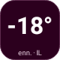
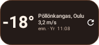
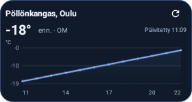
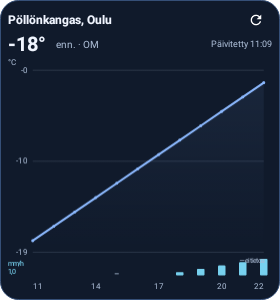

# Ajanlaskut · Sää Android 0.1.0

Ensimmäinen asennettava Android-testiversio, Android 8.0 tai uudempi.
Sovellus toimii itsenäisesti ilman Ubuntu-ohjelmaa.

**[Lataa APK puhelimeen](https://github.com/Jakke77/Ajanlaskut-ja-Saa/raw/refs/heads/packages/android/v0.1.0/Ajanlaskut-Saa-Android-0.1.0.apk).**
Yksityinen repo edellyttää GitHubiin kirjautumista. Avaa ladattu tiedosto ja
salli pyydettäessä asennus käyttämällesi selaimelle tai tiedostosovellukselle.
APK on kehitysavaimella allekirjoitettu testiversio, eikä sitä ole Google Playssa.

- **1×1:** valitun palvelun nykyisen tunnin lämpötilaennuste.
- **2×1:** lämpötila, tuuli, paikka ja päivitysaika.
- **4×2:** 12/24 tunnin ennuste. Widgettiä voi suurentaa esimerkiksi 4×4-kokoon.

Jokaiselle voi valita oman paikan, palvelun ja värit. Avaa sovellus tai lisää
widget kotinäytön **Widgetit → Ajanlaskut · Sää** -valikosta.
Ilmaiset ennustelähteet ovat Yr/MET Norway, Ilmatieteen laitos ja Open-Meteo.
**Enn.** tarkoittaa ennustetta, ei havaintoaseman mittausta.
Forecan ja FMI:n sadekartat sekä Windyn kartta/tuntiennuste avautuvat palvelujen
omina verkkonäkyminä sovelluksessa. Forecan/Windyn omiin widgettiarvoihin
tarvittaisiin erilliset API-oikeudet.

[Tarkat käyttö- ja rakennusohjeet](https://github.com/Jakke77/Ajanlaskut-ja-Saa/tree/codex/android-weather)
· [Lähdekoodin ZIP](https://github.com/Jakke77/Ajanlaskut-ja-Saa/raw/refs/heads/packages/android/v0.1.0/Ajanlaskut-Saa-Android-0.1.0-lahdekoodi.zip)
· [SHA256SUMS](SHA256SUMS)

37 testiä läpäisi, Androidlintissä 0 virhettä. Testeissä suoritettiin oikeat
Android RemoteViews-asettelut ja Canvas-piirto, myös −42° yhden ruudun widgetissä
fonttiskaalalla 1,3. APK:n allekirjoitus ja widgettien metadata tarkistettiin.
Kolmen sääpalvelun parserit tarkistettiin todellisilla API-vastauksilla.
**Fyysistä Android-puhelinta tai valmistajien kotinäyttösovelluksia ei testattu.**
[QA-raportti](qa/toolchain-verification.json).

Alla ovat oikeat Android-testirenderöinnit **esimerkkiennusteella**:

