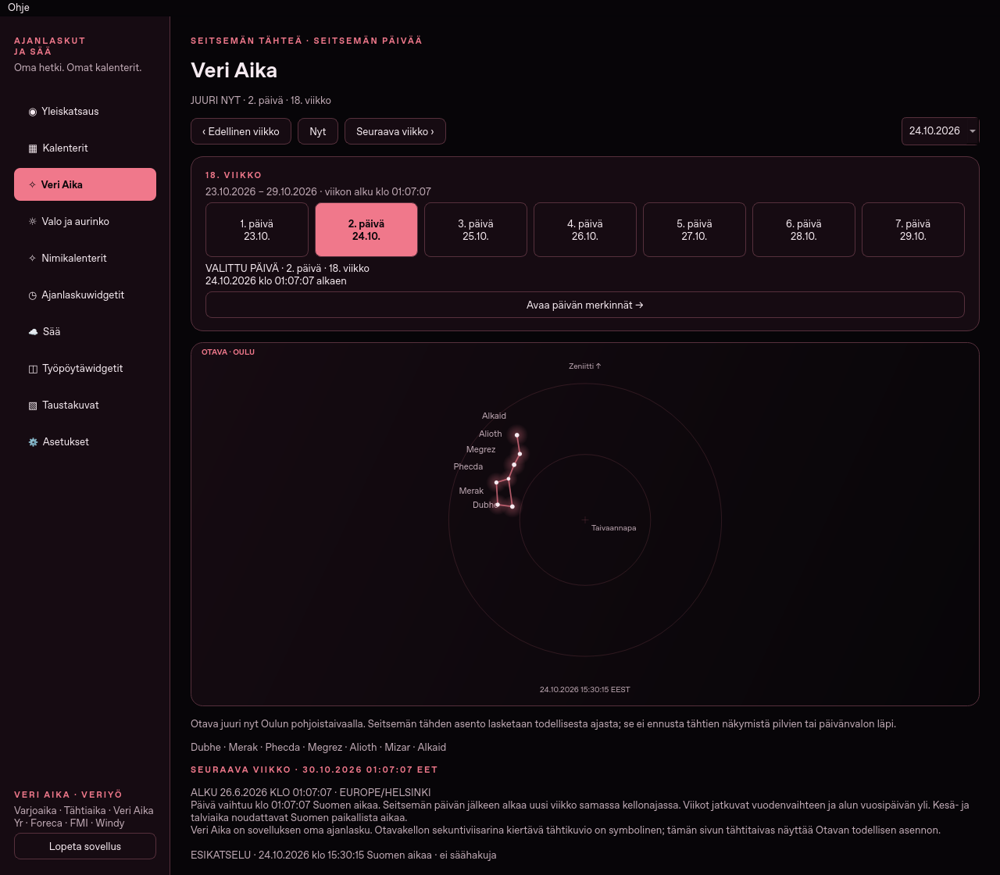
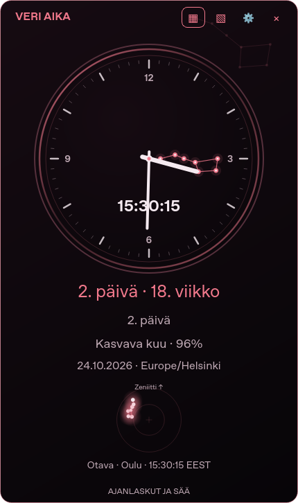

# Ajanlaskut ja Sää 1.12.0 · Veri Aika ja Otavakello

**[Lataa Ubuntu-deb](https://github.com/Jakke77/Ajanlaskut-ja-Saa/raw/refs/heads/packages/v1.12.0/ajanlaskut-ja-saa_1.12.0_all.deb)**
· [Lähdekoodin ZIP](https://github.com/Jakke77/Ajanlaskut-ja-Saa/raw/refs/heads/packages/v1.12.0/Ajanlaskut-ja-Saa-1.12.0-lahdekoodi.zip)
· [Windows 10/11 x64](https://github.com/Jakke77/Ajanlaskut-ja-Saa/releases/tag/windows-v1.12.0)
· [SHA256SUMS](SHA256SUMS).

Yksityinen repo edellyttää GitHubiin kirjautumista.

## Uudet toiminnot

- **Veri Aika** löytyy sivuvalikosta ja Kalenterit-valinnasta. Alku on
  **26.6.2026 klo 01:07:07 Suomen aikaa**. Päivä vaihtuu samassa kellonajassa,
  ja uusi viikko alkaa aina seitsemän paikallisen päivän jälkeen. Viikot
  jatkuvat yli vuodenvaihteen ja vuosipäivän. Suomen kesä- ja talviaika huomioidaan.
- **Otavan todellinen asento Oulussa** näkyy etusivulla, Veri Ajan kalenterissa
  ja kellon valinnaisessa sisältökentässä. Seitsemän tähden kuvio liikkuu
  todellisen ajan mukaan pohjoisen taivaannavan ympärillä. Ylös on zeniitti,
  oikealle itä. Laskenta toimii offline vuosille 1900–2100. Se kuvaa tähtien
  geometriaa, ei näkyvyyttä pilvien tai päivänvalon läpi.
- **Ajanlaskuwidgetit → Näyttötapa → Otavakello** tai **Otavakello ja digitaalinen**:
  tunti- ja minuuttiviisarit näyttävät ajan ja Otavan seitsemän tähden kuvio
  toimii symbolisena sekuntiviisarina. Tämä kuvio kiertää kerran minuutissa;
  erillinen taivaskuva näyttää oikean asennon. Sekuntivalinta piilottaa sekuntikuvion.
- **Asetukset → Teema → Veri Aika · Veriyö**: lähes musta viininpunainen paletti,
  kaksi taustakuvaa ja Ubuntu-versiossa yhteensopiva 423 SVG-kuvakkeen teema.
  Taustakuvat löytyvät Taustakuvat-sivulta. Niiden tähtikuviot ovat staattista kuvitusta.

Valitse kellon ajanlaskuksi Veri Aika tai lisää se vaihtoon osallistuvien
ajanlaskujen joukkoon ja tallenna. Vanha tallennettu kiertojoukko säilyy päivityksessä.
Widgettien teemat ja sisältövalinnat tallentuvat erikseen.

## Ubuntu-asennus

Avaa pääte latauskansioon:

```bash
sudo apt install ./ajanlaskut-ja-saa_1.12.0_all.deb
```

Sulje vanha ohjelma **Lopeta sovellus** -komennolla. Pelkkä ikkunan × voi
piilottaa sen. Käynnistä päivitetty järjestelmäasennus:

```bash
/usr/bin/ajanlaskut-ja-saa --page blood
/usr/bin/ajanlaskut-ja-saa --version
```

Versioksi tulee **1.12.0**. Merkinnät ja asetukset säilyvät.
`codex-ajanlasku` on erillinen käyttäjäasennus ja tarvitsee oman päivityksensä.
Viides kuvaketeema ylittää vanhan käyttäjäpäivittimen 2000 tiedoston rajan;
1.12.0:n helper sallii enintään 4096 tiedostoa säilyttäen tavumäärä- ja
polkutarkistukset. Päivitä myös helper käyttöönottoketjun mukaisesti.
[Asennus- ja päivitysohje](https://github.com/Jakke77/Ajanlaskut-ja-Saa/blob/codex/veri-aika-otava/UPDATES.md).

## Tarkistukset

Ubuntu: **370 yksikkö- ja Qt-testiä** sekä laaja oikean käyttöliittymän
hyväksyntä fontti-, koko-, teema-, tallennus- ja widgettiyhdistelmillä.
Otavan laskenta täsmää riippumattomaan Astropy/ERFA-vertailuun alle 0,01° erolla.
Uudet näkymät tarkistettiin myös 1020×720-ikkunassa.
Windows: **90 testiä natiivilla Windows-runnerilla**, käyttöliittymän hyväksyntä
sekä Yr:n ja FMI:n TLS-haut paketin omilla varmenteilla.
[Windows-ajo](https://github.com/Jakke77/Ajanlaskut-ja-Saa/actions/runs/40094226230).

[Testiloki](QA-unit.log) · [Qt-tarkistus](QA-ui.json) · [Pakettivertailu](QA-package.json)
· [Käyttöliittymän hyväksyntä](QA-self-test-summary.txt).



