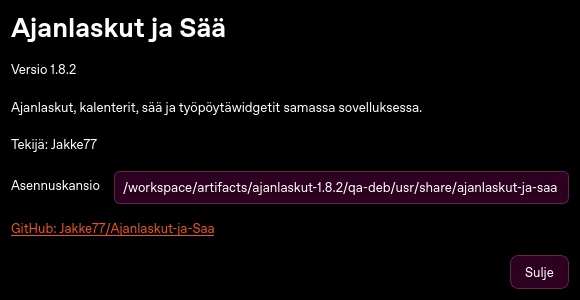

# Ajanlaskut ja Sää 1.8.2 · Tietoa sovelluksesta

[Lataa ajanlaskut-ja-saa_1.8.2_all.deb](https://github.com/Jakke77/Ajanlaskut-ja-Saa/raw/refs/heads/packages/v1.8.2/ajanlaskut-ja-saa_1.8.2_all.deb).
Yksityinen repo edellyttää GitHubiin kirjautumista. Tiedoston **Download raw file** lataa paketin.
Lataa myös [SHA256SUMS](SHA256SUMS) halutessasi tarkistamista varten.

Asenna latauskansiosta:

```bash
sudo apt install ./ajanlaskut-ja-saa_1.8.2_all.deb
```

**Valitse vanhasta ohjelmasta Lopeta sovellus.** Ikkunan × voi vain piilottaa sen.
Käynnistä uusi järjestelmäasennus komennolla `/usr/bin/ajanlaskut-ja-saa`.
Ikkunan otsikossa ja alareunassa näkyy nyt **1.8.2**.

## Tietoa sovelluksesta

**Ohje → Tietoa sovelluksesta** näyttää käynnissä olevan version ja sen asennuskansion.
Sama toiminto löytyy Asetuksista, sääwidgetin valikosta ja ilmoitusalueelta.
Versio ja asennuskansio ovat kopioitavissa.



## Windy-kartan latauskorjaus

Kartta ladataan vasta näkymän ilmestymisen ja koon valmistumisen jälkeen.
**Sää → Päivitä** lataa molemmat näkyvät Windy-kartat myös ennustehaun ollessa kesken.
Latausvirheessä **Yritä uudelleen** tekee uuden yrityksen, ja **Avaa Windy selaimessa** avaa saman rajauksen selaimeen.
Kartanäkymän avaaminen uudelleen yrittää epäonnistuneen latauksen uudelleen.
Tavallinen ennuste- tai ulkoasupäivitys säilyttää toimivan kartan ja näkyvän virheen.

## Ubuntu 26.10 Dark

Valitse **Asetukset → Teema → Ubuntu 26.10 Dark** ja tallenna.
**Käytä valittua teemaa kaikissa widgeteissä** vaihtaa myös erikseen valitut widgettien teemat.
Paletti käyttää [Ubuntun virallisia brändivärejä](https://design.ubuntu.com/brand/colour-palette).
Taustakuva seuraa teemaa, jos **Taustakuva teeman vaihtuessa → Vaihda teeman mukana** on käytössä.
Sen voi ottaa käyttöön myös **Taustakuvat → Aseta Ubuntu 26.10 Dark-teeman tausta** -painikkeella.


## Kuvaketoiminnot

Avaa **Asetukset → vieritä alas → Sovelluskuvakkeet** tai vastaava kohta **Taustakuvat**-sivulta.

1. **Asenna ja korjaa sovelluskuvakkeet** asentaa neljä teemaa ja korjaa myös Firefoxin ja Thunderbirdin Snap-käynnistimet sekä GIMPin apt-kuvan.
2. **Käytä nykyisen teeman kuvakkeita** vaihtaa kuvakkeet heti.
3. **Kuvakkeet teeman vaihtuessa → Vaihda teeman mukana** ja tallennus ottaa vapaaehtoisen automaattisen vaihdon käyttöön.
4. **Käytä järjestelmän oletuskuvakkeita** palauttaa koneen oman oletusteeman ja sovelluksen tekemät käynnistinkuvakekorjaukset. Se poistaa kuvakkeiden automaattisen vaihdon käytöstä ja säilyttää widgettien teeman sekä taustakuvan.


Teemapaketit sisältyvät sovellukseen. Kuvakevaihto ei tarvitse verkkolatausta.
Oletuksena nykyiset kuvakkeet säilyvät. Palautuspainikkeet palauttavat aiemman teeman ja käynnistinkuvakkeet.

## Jos käytät codex-ajanlasku-käyttäjäasennusta


Jos `/usr/bin/ajanlaskut-ja-saa --version` näyttää esimerkiksi **1.8.1** mutta
`codex-ajanlasku run --version` näyttää **1.6.0**, deb on päivittänyt vain
järjestelmäasennuksen. Ubuntu 26.10 Dark puuttuu vanhasta käyttäjäasennuksesta.
Versio 1.8.2 lisää **Ohje → Tietoa sovelluksesta** -toiminnon, josta näet
käynnissä olevan ohjelman version ja asennuskansion.

Saat jo asennetun järjestelmäversion näkyviin näin:

1. Valitse nykyisestä ohjelmasta **Lopeta sovellus**. Ikkunan × voi vain piilottaa sen.
2. Aja `/usr/bin/ajanlaskut-ja-saa --page settings`.
3. Valitse **Asetukset → Ulkoasu ja työpöytä → Teema → Ubuntu 26.10 Dark** ja tallenna.

Päivitä myös käyttäjäasennus järjestelmään asennetusta versiosta alla olevalla
ketjulla. Se lukee nykyisen `codex-ajanlasku`-komennon päivityskansion, joten
myös oma erikseen valittu kansio säilyy. Aja ilman sudoa:

```bash
(
  set -eu
  umask 022
  ajanlasku_kanava="$(codex-ajanlasku status | /usr/bin/python3 -c 'import sys; p="Päivityskansio: "; c=next((r[len(p):].rstrip("\n") for r in sys.stdin if r.startswith(p)), ""); print(c) if c.startswith("/") else sys.exit("Päivityskansiota ei löytynyt. Tarkista codex-ajanlasku status.")')"
  /usr/bin/python3 /usr/share/ajanlaskut-ja-saa/packaging/build.py \
    --publish-channel "$ajanlasku_kanava" &&
  /usr/bin/python3 "$ajanlasku_kanava/update-upgrade.py" setup &&
  "$HOME/.local/bin/codex-ajanlasku" update &&
  "$HOME/.local/bin/codex-ajanlasku" upgrade &&
  "$HOME/.local/bin/codex-ajanlasku" run --version
)
```

Ketjun ensimmäinen rakentamisvaihe testaa paketin ja voi kestää useita minuutteja.
Jos jokin vaihe epäonnistuu, ketju pysähtyy. Kun lopun versionumero vastaa
järjestelmäasennusta, lopeta vanha ohjelma kokonaan ja avaa
`"$HOME/.local/bin/codex-ajanlasku" run --page settings`.
Kalenterimerkinnät säilyvät; älä poista asetuskansiota.

## Tarkistus

```bash
sha256sum -c SHA256SUMS
```

244 testiä läpäisi. Lopullisesta debistä tarkistettiin versionumero, Tietoa-toiminto sekä Dark-teemavalikko (kuusi Qt-testiä).
Eristetyssä testikansiossa alkuperäinen Git-version 1.6.0 käyttäjäasennus päivitettiin 1.8.2:een samassa omassa päivityskansiossa. Käynnistimet seurasivat uutta versiota, aiempi versio jäi palautettavaksi ja merkinnät sekä asetukset säilyivät tavuntarkasti.
Katso [QA.log](QA.log) ja [käyttäjäasennuksen päivitystesti](upgrade-user-install.log). Paketti vaatii Python 3.10:n ja PyQt6:n vähintään 6.8.

[Lähdekoodi ja täydet päivitysohjeet](https://github.com/Jakke77/Ajanlaskut-ja-Saa/tree/codex/about-application).
