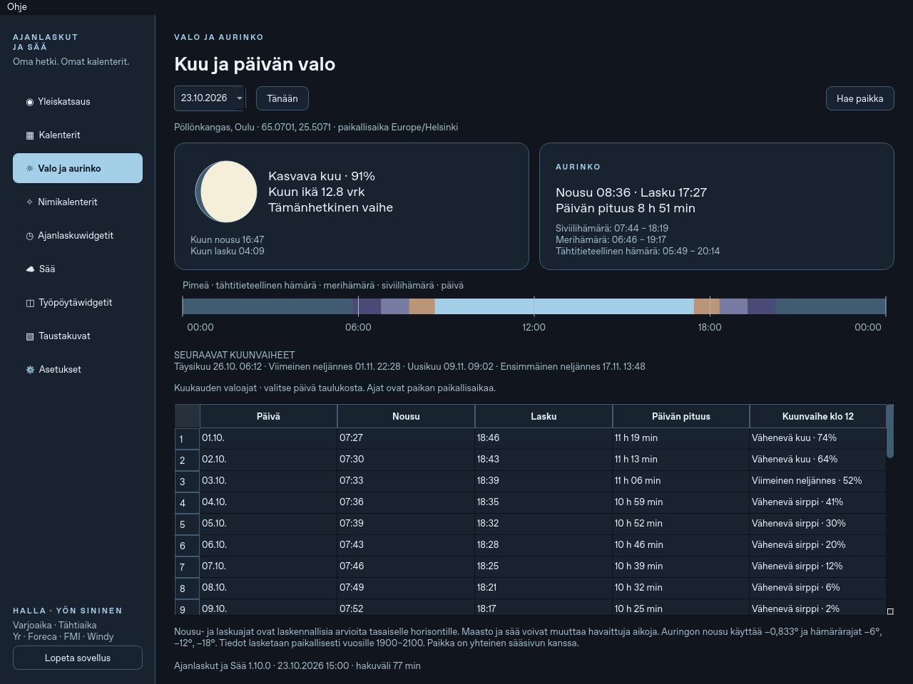

# Ajanlaskut ja Sää 1.10.0 · Kuu, nimikalenterit ja päivän valo

**[Lataa deb-paketti](https://github.com/Jakke77/Ajanlaskut-ja-Saa/raw/refs/heads/packages/v1.10.0/ajanlaskut-ja-saa_1.10.0_all.deb)**
· [Lähdekoodin ZIP](https://github.com/Jakke77/Ajanlaskut-ja-Saa/raw/refs/heads/packages/v1.10.0/Ajanlaskut-ja-Saa-1.10.0-lahdekoodi.zip)
· [SHA256SUMS](SHA256SUMS).
Yksityinen repo edellyttää GitHubiin kirjautumista.

## Uudet toiminnot

- **Todellinen kuunvaihe:** kellot näyttävät saman vaiheen ja valaistun osuuden.
  Kalenterin valitulle päivälle näytetään vaihe klo 12 kalenterin aikavyöhykkeellä.
- **Nimikalenterit → Oma nimi:** valitse syntymäpäivä ja katso oma miehen ja
  naisen nimesi kolmessa kalenterissa. Varjoajalla on 390 ja Tähtiajalla 510
  pysyvää nimiparia. Haku toimii myös ennen ajanlaskujen alkupäiviä. Nimet ovat
  sovellusta varten keksittyjä, eivät virallisia nimipäiviä.
- **Nimikalenterit → Suomalainen kuukalenteri:** oikeat uudetkuut, 29–30 päivän
  kuukaudet, Vaahtokuu 13 kuukauden vuodessa ja 390 suomalaishenkistä nimiparia.
  Kuukausisääntö on selvästi merkitty sovelluksen laskennalliseksi tulkinnaksi
  [Katajalan kuvauksesta](https://www.katajala.net/viikinkiaika/ajanlasku/suomalainen_kalenteri.html).
  Joulukuu sisältää talvipäivänseisauksen ja Vaahtokuu seuraa helmikuuta.
  Kuukausi alkaa uudenkuun Helsingin päivämääränä. Lähde ei määritä tätä tarkkaa
  sääntöä. Päivän merkinnät ovat yhteisiä muiden kalenterien kanssa.
- **Valo ja aurinko:** Auringon ja Kuun nousu- ja laskuajat, päivän pituus,
  kolme hämärärajaa, kuun kuva, seuraavat päävaiheet ja kuukauden valoajat.
  Hae paikka tai käytä sääsivulla valittua paikkaa. Ajat näytetään paikan
  aikavyöhykkeellä kesäaika huomioiden.

Tähtilaskenta toimii paikallisesti vuosille 1900–2100 ilman API-avaimia tai
uusia riippuvuuksia. Nousuajat ovat arvioita tasaiselle horisontille; maasto
ja sää voivat muuttaa havaittuja aikoja. Kaamos, yötön yö ja päivät, joina
Kuulla on vain nousu tai lasku, käsitellään erikseen.

Kalenterit-sivulla on suorat linkit uusiin toimintoihin. Mukana ovat myös
aiemmat sadekartat, Windyn tuntiennuste, teemat, kuvakkeet ja taustakuvat.

## Asentaminen

Avaa pääte latauskansioon:

```bash
sudo apt install ./ajanlaskut-ja-saa_1.10.0_all.deb
```

Sulje vanha ohjelma **Lopeta sovellus** -komennolla. Pelkkä ikkunan × voi
piilottaa vanhan prosessin. Käynnistä järjestelmäasennus:

```bash
/usr/bin/ajanlaskut-ja-saa --page sunmoon
/usr/bin/ajanlaskut-ja-saa --version
```

Versioksi tulee **1.10.0**. Asetukset ja kalenterimerkinnät säilyvät.
Ubuntun PyQt6:n pitää olla vähintään 6.8.

**Jos käynnistät `codex-ajanlasku run` -komennolla**, päivitä myös sen erillinen
käyttäjäasennus. Pelkkä deb-asennus ei päivitä sitä.
[Nykyisen päivityskansion säilyttävä käyttöönottoketju](https://github.com/Jakke77/Ajanlaskut-ja-Saa/blob/codex/moon-names-daylight/UPDATES.md#eri-versiot-järjestelmä--ja-käyttäjäasennuksessa)
ja [lähde-ZIPistä päivittäminen](https://github.com/Jakke77/Ajanlaskut-ja-Saa/blob/codex/moon-names-daylight/UPDATES.md#uuden-github-version-tuominen-nykyiseen-käyttäjäasennukseen).

## Tarkistukset ja esikatselut

**332 testiä läpäisi.** USNO-vertailu varmisti nousuajat ja kuunvaiheet.
Vuosien 1900–2100 talvipäivänseisauksen edellinen uusikuu, Vaahtokuu ja 12/13
kuukauden vuodet tarkistettiin. Oikea Qt avasi kaikki uudet näkymät myös
1020×720-ikkunassa ja tallensi suomalaisen kalenterin merkinnän yhteiselle
päivälle. Paketissa ja lähde-ZIPissä kaikki 1 877 tiedostoa täsmäävät lähdekoodiin.

[Testiloki](QA-unit.log) · [Tähtitietojen vertailu](QA-astronomy.md)
· [Qt-tarkistus](QA-ui.json) · [Pakettitarkistus](QA-package.json).




