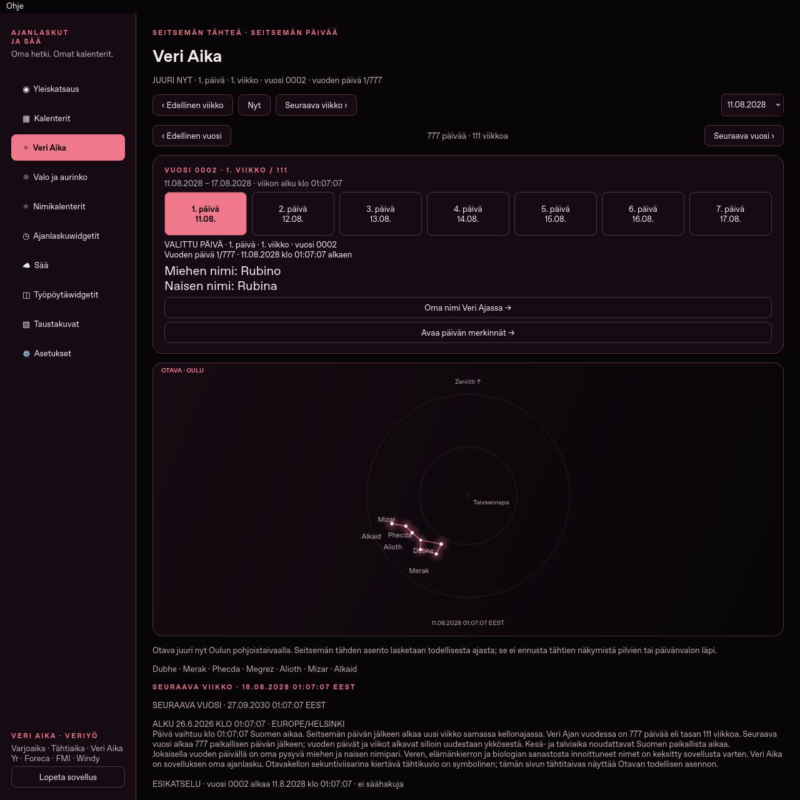
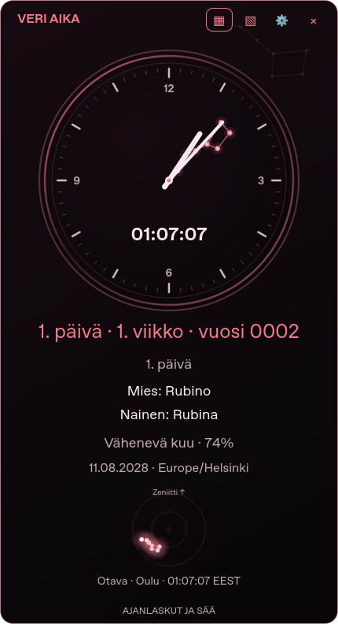
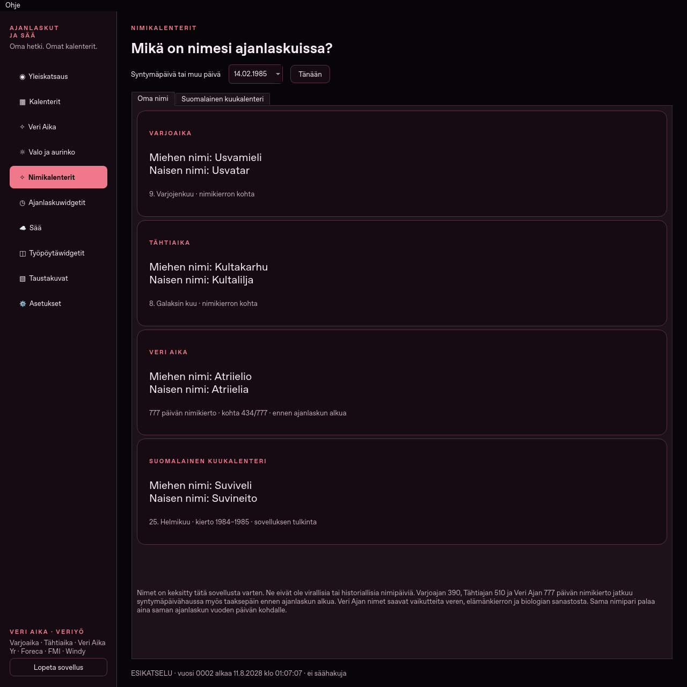

# Ajanlaskut ja Sää 1.12.1 · Veri Ajan 777 päivän vuosi

**[Lataa Ubuntu-deb](https://github.com/Jakke77/Ajanlaskut-ja-Saa/raw/refs/heads/packages/v1.12.1/ajanlaskut-ja-saa_1.12.1_all.deb)**
· [Lähdekoodin ZIP](https://github.com/Jakke77/Ajanlaskut-ja-Saa/raw/refs/heads/packages/v1.12.1/Ajanlaskut-ja-Saa-1.12.1-lahdekoodi.zip)
· [Windows 10/11 x64](https://github.com/Jakke77/Ajanlaskut-ja-Saa/releases/tag/windows-v1.12.1)
· [SHA256SUMS](SHA256SUMS).

Yksityinen repo edellyttää GitHubiin kirjautumista.

## Veri Ajan uusi vuosi ja nimet

Vuodessa on **777 päivää eli 111 täyttä seitsemän päivän viikkoa**.
Alkuhetki säilyy 26.6.2026 klo 01:07:07 Suomen aikaa. Vuosi 0002 alkaa
**11.8.2028 klo 01:07:07**, jolloin vuoden päivä ja viikko palaavat ykköseen.
Päivien, viikkojen ja vuosien rajat noudattavat Suomen paikallista aikaa myös
kesä- ja talviaikana. Vuosi ei vaihdu gregoriaanisen vuoden tai alun vuosipäivän kohdalla.

Jokaisella vuoden päivällä on oma pysyvä miehen ja naisen nimipari: yhteensä
**777 paria eli 1 554 nimeä**. Ne ammentavat verestä, verenkierrosta, soluista
ja elämän sanastosta. Esimerkiksi **Rubino / Rubina**, **Hemero / Hemera**,
**Sanguino / Sanguina**, **Fibriano / Fibria** ja **Valterio / Valteria**.
Nimet on keksitty tätä sovellusta varten, ja sama pari toistuu saman vuodenpäivän kohdalla.

Nimet näkyvät **Veri Aika** -sivulla, päivän vihjeessä ja etusivulla.
**Nimikalenterit → Oma nimi** hakee parin myös omasta syntymäpäivästä;
nimikierto jatkuu taaksepäin ennen ajanlaskun alkua. Widgetin nimirivejä
säädetään **Ajanlaskuwidgetit → Näkyvä sisältö → Päivän nimipari** -valinnalla.
Yhteisessä ja Veri Ajan kellossa ne ovat oletuksena näkyvissä.

Kalenterissa voi siirtyä myös 777 päivää edelliseen tai seuraavaan vuoteen.
Otavan todellinen asento, symbolinen Otavakello, Veriyö ja taustakuvat säilyvät.
Merkinnät ja aiemmat asetukset säilyvät päivityksessä.

## Asentaminen

Ubuntu: avaa pääte latauskansioon ja suorita:

```bash
sudo apt install ./ajanlaskut-ja-saa_1.12.1_all.deb
```

Sulje vanha ohjelma **Lopeta sovellus** -painikkeella ja avaa päivitetty asennus:

```bash
/usr/bin/ajanlaskut-ja-saa --page blood
/usr/bin/ajanlaskut-ja-saa --version
```

Versioksi tulee **1.12.1**. `codex-ajanlasku` on erillinen käyttäjäasennus;
[sen päivitysohje](https://github.com/Jakke77/Ajanlaskut-ja-Saa/blob/codex/veri-777-names/UPDATES.md)
on lähdekoodin mukana.

Windows: pura uuden version ZIP uuteen kansioon ja avaa sen
**Ajanlaskut-ja-Saa.exe**. Sulje ensin vanha ohjelma. Jos käytät pikakuvakkeita,
uuden kansion **Luo-pikakuvakkeet.cmd** päivittää ne käyttämään uutta kansiota.
Omat tiedot säilyvät käyttäjäkansiossa erillään ohjelmasta.

## Tarkistukset

**390 yksikkö- ja Qt-testiä läpäisi**: vuoden viimeinen ja ensimmäinen
sekunti, 777 paikallisen päivän kesto, nimiluettelon eheys ja pysyvyys,
syntymäpäivät ennen alkua, asetusten täydentyminen ja widgetin vakaa koko.
Oikea Qt-käyttöliittymä tarkistettiin myös 1020×720-koossa.
Kaikki **2 321** deb- ja lähde-ZIP-tiedostoa verrattiin lähteeseen;
myös turvallinen käyttäjäpäivittimen purku tarkistettiin.

Windowsin paketti rakennetaan ja testataan natiivilla Windows-runnerilla:
[Windows-ajo 40104633005](https://github.com/Jakke77/Ajanlaskut-ja-Saa/actions/runs/40104633005).

[Testiloki](QA-unit.log) · [Qt-tarkistus](QA-ui.json) · [Pakettivertailu](QA-package.json).




